# Plateforme CSE : gestion des matériels, achats et pilotage

Système de management et de suivi des matériels et équipements de la **Compagnie Sahélienne d'Entreprises**
(BTP, Sénégal) : expression et validation des besoins des chantiers, gestion du parc (affectations,
maintenance, pannes, réforme), achats (appels d'offres anonymisés, évaluation multicritère, contrats,
engagements, factures), référentiel fournisseurs, **portail fournisseur** (inscription, offres, signature des
contrats, expédition, factures), tableaux de bord par profil, assistant IA, notifications et journal d'audit.

Projet de Master (MILIA, EPT), encadré par le Pr. Guissé. Version **2.1.0** ([CHANGELOG](CHANGELOG.md)). Démonstration guidée pour un jury : [docs/DEMO.md](docs/DEMO.md).

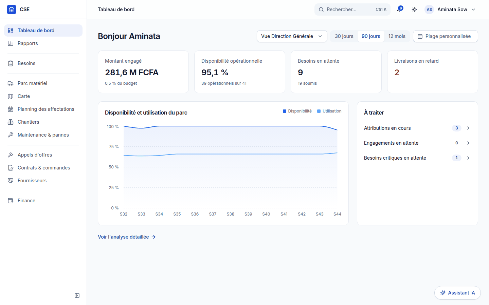

## Aperçu

| Validation des besoins (Responsable Matériel) | Carte du parc (mode sombre) |
|---|---|
| 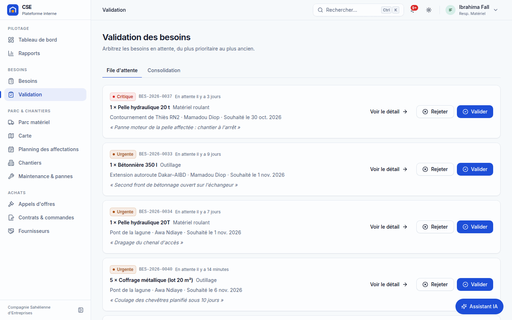 | 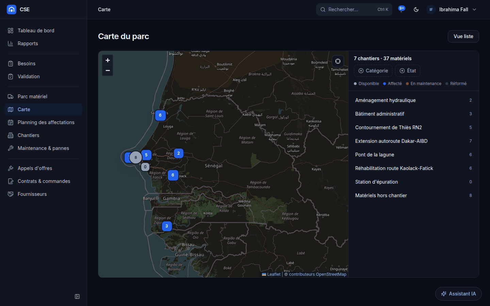 |
| **Évaluation des offres d'un appel d'offres** | **Contrat en livraison** |
| 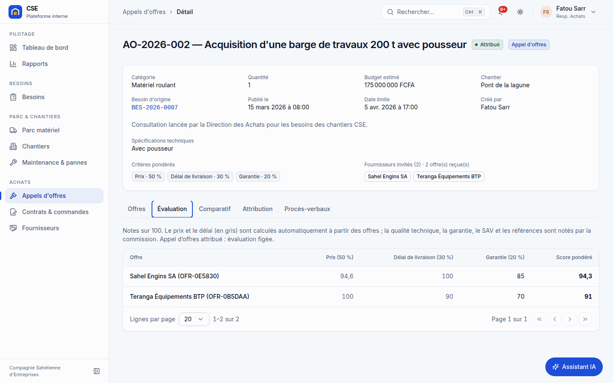 | 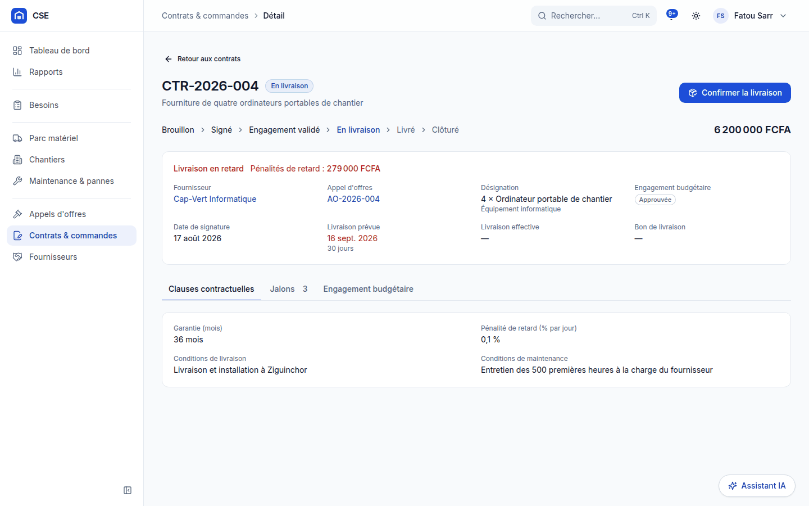 |
| **Planning des affectations** | **Assistant IA** |
| 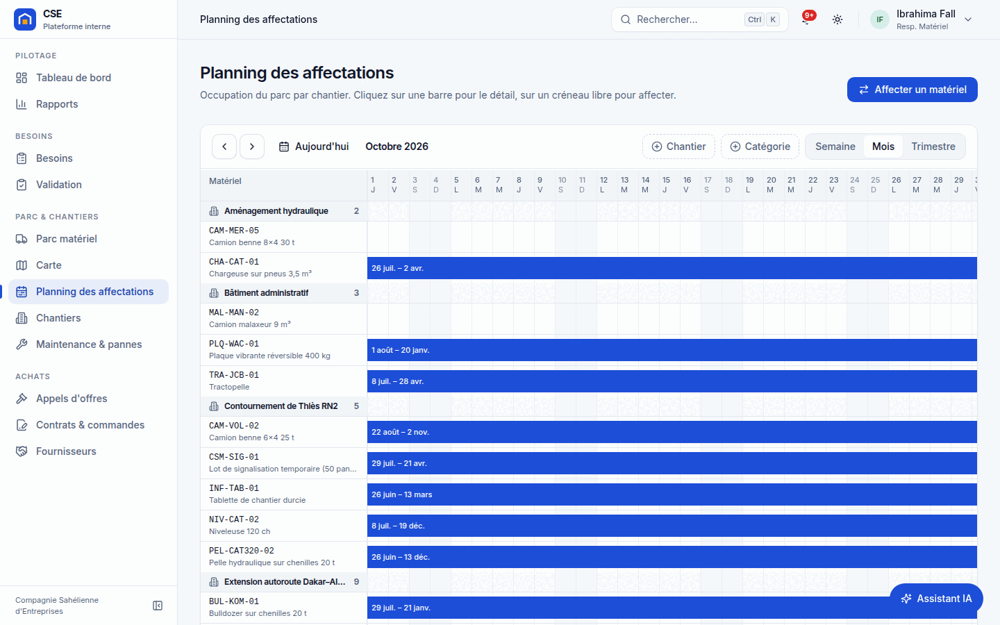 | 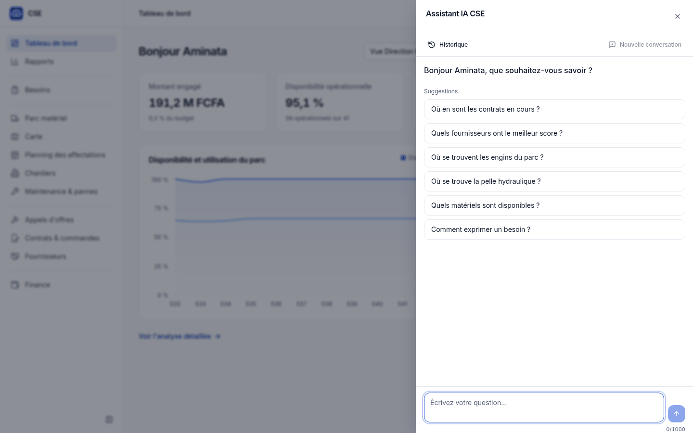 |
| **Finance (DAF)** | **Journal d'audit (Administrateur)** |
| 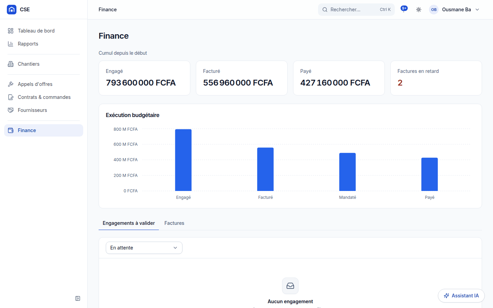 | 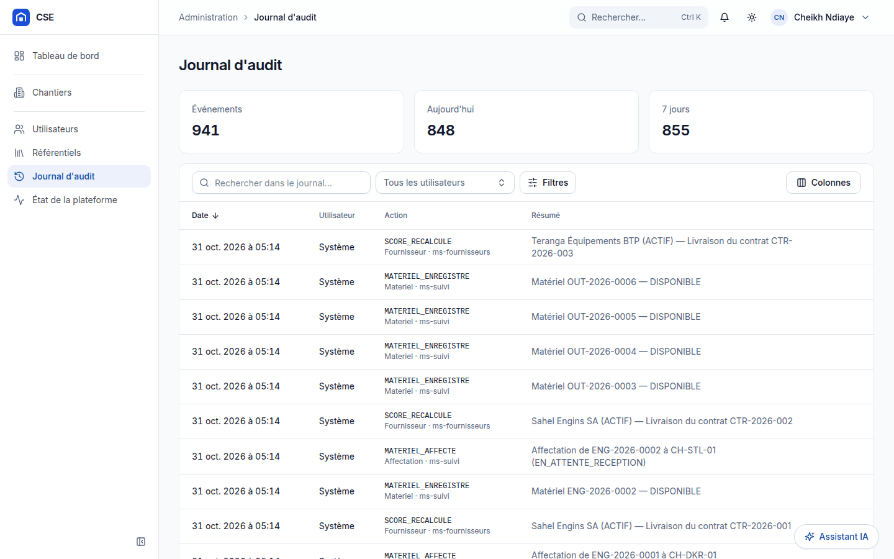 |

| **Portail fournisseur : accueil** | **Portail fournisseur : contrat à signer** |
| 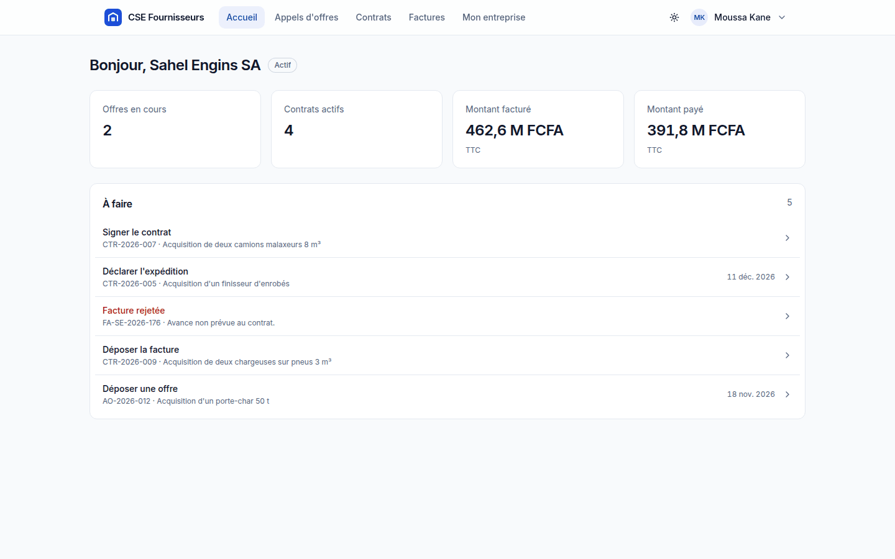 | 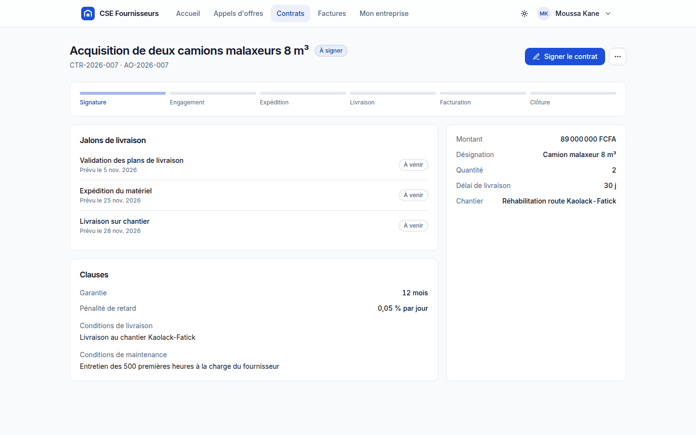 |

Sur mobile : 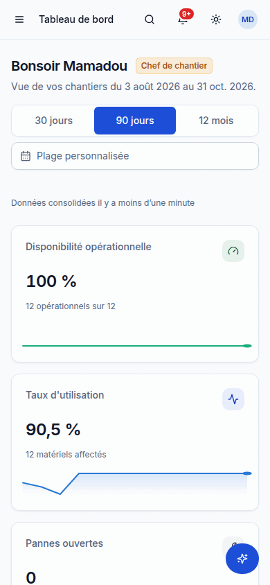

Toutes les captures sont commentées dans le [guide utilisateur](docs/USER_GUIDE.md).

## Architecture

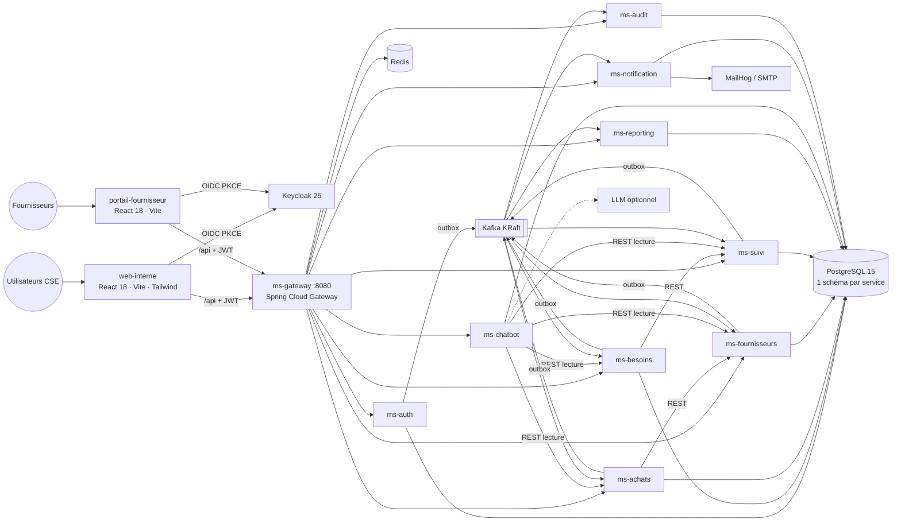

Dix microservices en architecture hexagonale, base de données par service, REST synchrone + événements Kafka
(outbox transactionnelle, consommateurs idempotents, DLT), sécurité Keycloak vérifiée à la passerelle et dans
chaque service. Détails : [docs/architecture.md](docs/architecture.md).

## Stack

| Couche | Technologies |
|---|---|
| Backend | Java 17, Spring Boot 3.5, Spring Cloud 2025.0 (Gateway, Resilience4j), Spring Security OAuth2 Resource Server, Spring Data JPA, Flyway, Spring Kafka, Spring AI 1.0, springdoc-openapi, OpenPDF, Apache POI |
| Données et messagerie | PostgreSQL 15, Kafka 3.7 (KRaft), Redis 7 |
| Identité | Keycloak 25 (realm `cse`, PKCE, rôles realm, claims `chantier_ids` / `fournisseur_id`) |
| Frontend | React 18, TypeScript strict, Vite 5, Tailwind CSS, Radix UI, TanStack Query/Table, react-hook-form + zod, keycloak-js, i18next, Recharts, react-leaflet |
| Qualité | JUnit 5, Mockito, AssertJ, Testcontainers, WireMock, ArchUnit, JaCoCo, Spotless ; Vitest, Testing Library, MSW, Playwright ; k6 |
| Exploitation | Docker multi-étapes non-root, Docker Compose, Nginx HTTPS, sauvegardes `pg_dump`, GitHub Actions |

## Démarrage en 5 commandes

Prérequis : **Docker** (Compose v2), **JDK 17**, **Maven ≥ 3.9**, **Node 20 + pnpm** (`corepack enable`),
environ 12 Go de RAM.

```bash
cp .env.example .env && sed -i "s|^CSE_CRYPTO_KEY=.*|CSE_CRYPTO_KEY=$(head -c32 /dev/urandom | base64)|" .env
make infra    # PostgreSQL, Kafka, Keycloak (import du realm), Redis, MailHog, attend que Keycloak soit prêt
make build    # compile les 12 modules Maven (tests inclus ; plusieurs minutes)
make start    # lance les 10 microservices sur l'hôte (profil dev, données de démonstration) ; make status
make front    # http://localhost:5173 (la première fois : pnpm --dir frontend install)
```

Portail fournisseur, dans un second terminal : `make portail` (ou `scripts/cse.sh portail`), sur
http://localhost:5174.

Ouvrir http://localhost:5173 et se connecter avec un compte ci-dessous (portail : `fournisseur@cse.sn`).
Les deux applications partagent la session Keycloak : pour être à la fois agent CSE et fournisseur, utiliser
deux navigateurs ou une fenêtre privée. Les services génèrent leur jeu de
démonstration au premier démarrage (chantiers, parc, besoins, fournisseurs, appels d'offres, contrats,
factures sur 9 mois) ; compter 2 à 3 minutes pour que les tableaux de bord soient complets.

Plateforme entièrement conteneurisée avec frontal HTTPS (https://localhost:8443) : `make up`, voir
[docs/OPERATIONS.md](docs/OPERATIONS.md).

## Comptes de démonstration

Mot de passe commun : **`Cse@2026`** (realm de développement uniquement).

| E-mail | Nom | Rôle | Particularités |
|---|---|---|---|
| `chef.chantier@cse.sn` | Mamadou Diop | Chef de chantier (`CHEF_CHANTIER`) | chantiers CH-DKR-01 et CH-THS-01 |
| `awa.ndiaye@cse.sn` | Awa Ndiaye | Chef de chantier | chantiers CH-STL-01 et CH-KLK-01 |
| `resp.materiel@cse.sn` | Ibrahima Fall | Responsable Matériel (`RESPONSABLE_MATERIEL`) | valide les besoins, gère le parc |
| `resp.achats@cse.sn` | Fatou Sarr | Responsable Achats (`RESPONSABLE_ACHATS`) | appels d'offres, contrats, fournisseurs |
| `daf@cse.sn` | Ousmane Ba | DAF (`DAF`) | engagements, factures |
| `dg@cse.sn` | Aminata Sow | Direction Générale (`DIRECTION_GENERALE`) | lecture seule + arbitrages R09/R11/R13 |
| `admin@cse.sn` | Cheikh Ndiaye | Administrateur (`ADMIN_SYSTEME`) | utilisateurs, référentiels, audit |
| `fournisseur@cse.sn` | Moussa Kane | Fournisseur (`FOURNISSEUR`) | portail fournisseur, fournisseur F1 Sahel Engins SA |

Jeton pour les appels en ligne de commande : `TOKEN=$(scripts/token.sh dg@cse.sn)`.

## URL utiles

| Service | URL | Accès |
|---|---|---|
| Application web interne | http://localhost:5173 (dev) · https://localhost:8443 (`make up`) | comptes ci-dessus |
| Portail fournisseur | http://localhost:5174 (`make portail`) · inscription publique : http://localhost:5174/inscription | `fournisseur@cse.sn` |
| Passerelle d'API | http://localhost:8080/api | Bearer JWT |
| Swagger UI agrégé | http://localhost:8080/swagger-ui.html | bouton « Authorize » (client `cse-swagger`, PKCE) |
| Swagger d'un service | http://localhost:808N/swagger-ui.html | idem |
| État de la plateforme | http://localhost:8080/api/plateforme/etat · écran Administration | rôle interne |
| Console Keycloak | http://localhost:8180/admin | `KEYCLOAK_ADMIN` / `KEYCLOAK_ADMIN_PASSWORD` de `.env` |
| MailHog (e-mails envoyés, dont « définir votre mot de passe » des fournisseurs validés) | http://localhost:8025 | - |
| Kafka | `localhost:9092` (hôte), `kafka:29092` (conteneurs) | `docker exec cse-kafka-1 kafka-topics.sh --bootstrap-server localhost:29092 --list` |
| PostgreSQL | `localhost:5433`, base `cse` | `ms_<service>` / `CSE_DB_PASSWORD` |

Ports des services : gateway 8080, auth 8081, besoins 8082, achats 8083, fournisseurs 8084, suivi 8085,
reporting 8086, chatbot 8087, notification 8088, audit 8089.

## Commandes `make`

| Cible | Effet |
|---|---|
| `make infra` | démarre l'infrastructure Docker |
| `make build` | compile et installe tous les modules (tests inclus) |
| `make start` / `make stop` / `make status` | microservices sur l'hôte (journaux dans `logs/`) |
| `make front` | application web interne en développement |
| `make portail` | portail fournisseur en développement (port 5174) |
| `make test` | tests backend |
| `make verify` | **porte de qualité** : `mvn verify` (Spotless, tests, ArchUnit, OpenAPI, JaCoCo ≥ 80 %) puis typecheck, lint, tests et build du front |
| `make front-verify` | porte de qualité du front seule (web interne + portail fournisseur) |
| `make e2e` | tests de bout en bout API et interface, dont le circuit complet avec le portail (plateforme et portail démarrés) |
| `make up` / `make images` / `make certs` | plateforme conteneurisée, images, certificats de développement |
| `make backup` / `make restore DUMP=…` | sauvegarde / restauration PostgreSQL |
| `make perf` | test de charge k6 |
| `make logs` / `make down` / `make clean` | journaux de l'infrastructure, arrêt complet, nettoyage |

Réinitialiser les données de démonstration : `scripts/cse.sh reset`.

## Organisation du dépôt

```
backend/             Maven : cse-common (socle), cse-events (contrats d'événements), ms-* (10 services, README chacun)
frontend/            pnpm : apps/web-interne, apps/portail-fournisseur, packages/*
infra/               docker-compose.yml, init PostgreSQL, realm Keycloak, Nginx, sauvegardes
scripts/             cse.sh, token.sh, smoke.sh, backup-now.sh, restore.sh, gen-certs.sh
tests/               perf (k6), tests de bout en bout
docs/                documentation, adr/, http/ (collections de requêtes), images/, inputs/ (sources du projet)
```

## Documentation

| Document | Contenu |
|---|---|
| [docs/USER_GUIDE.md](docs/USER_GUIDE.md) | guide utilisateur par rôle et portail fournisseur, avec captures |
| [docs/DEMO.md](docs/DEMO.md) | script de démonstration de bout en bout (15 min), raccourcis sur données préparées |
| [docs/architecture.md](docs/architecture.md) | C4, microservices, flux, séquences, correspondance UML ↔ code |
| [docs/API_CONTRACT.md](docs/API_CONTRACT.md) | contrat d'API et d'événements (référence) |
| [docs/events.md](docs/events.md) | catalogue Kafka, outbox, idempotence, DLT, audit |
| [docs/SECURITY.md](docs/SECURITY.md) | Keycloak, RBAC, matrice d'accès, chiffrement, OWASP |
| [docs/OPERATIONS.md](docs/OPERATIONS.md) | déploiement, variables, supervision, sauvegardes, dépannage |
| [docs/DEVELOPER_GUIDE.md](docs/DEVELOPER_GUIDE.md) | conventions, recettes, tests, portes de qualité, Git |
| [docs/BACKEND_CONVENTIONS.md](docs/BACKEND_CONVENTIONS.md) · [frontend CONVENTIONS](frontend/apps/web-interne/CONVENTIONS.md) | conventions détaillées |
| [docs/QUALITY_REPORT.md](docs/QUALITY_REPORT.md) | tests, couverture, DoD, dette |
| [DECISIONS.md](DECISIONS.md) · [docs/adr/](docs/adr/) | décisions d'architecture |
| [docs/http/](docs/http/) | collections de requêtes `.http` par service |
| [tests/perf/README.md](tests/perf/README.md) | test de charge |
| [CHANGELOG.md](CHANGELOG.md) | versions |
| `docs/inputs/` | cahier des charges, spécifications techniques, annexe UML |
