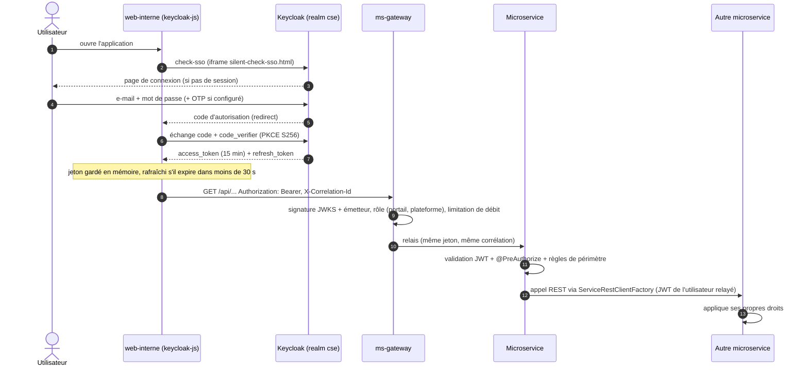

# Sécurité : plateforme CSE

Ce document décrit le modèle de sécurité **tel qu'il est implémenté** (code de `backend/cse-common`,
`backend/ms-gateway`, `infra/keycloak/realm-cse.json`, `infra/nginx/web-interne.conf`), la matrice d'accès
complète dérivée des annotations `@PreAuthorize`, et un bilan OWASP Top 10 avec ses écarts.

Décisions liées : [ADR-0002](adr/0002-keycloak-auth.md) (Keycloak), [ADR-0006](adr/0006-csrf-api-stateless.md)
(CSRF), [ADR-0007](adr/0007-outbox-et-audit.md) (audit), [ADR-0011](adr/0011-seuil-delegation.md) (seuil R11),
[ADR-0012](adr/0012-pas-de-mot-de-passe-local.md) (aucun mot de passe local),
[ADR-0013](adr/0013-ms-auth-synchronisation-keycloak.md) (synchronisation ms-auth).

## 1. Identité : Keycloak

Realm `cse` importé au **premier** démarrage de Keycloak 25 depuis `infra/keycloak/realm-cse.json`
(les modifications ultérieures du fichier ne sont pas réappliquées sur une base Keycloak existante :
voir [OPERATIONS.md](OPERATIONS.md) §9).

| Paramètre du realm | Valeur |
|---|---|
| Rôles realm | `CHEF_CHANTIER`, `RESPONSABLE_MATERIEL`, `RESPONSABLE_ACHATS`, `DAF`, `DIRECTION_GENERALE`, `ADMIN_SYSTEME`, `FOURNISSEUR` (constantes uniques : `sn.cse.common.security.Roles`) |
| Durée du jeton d'accès | 900 s (15 min) ; session SSO inactive 1 h |
| Politique de mot de passe | `length(8) and notUsername` |
| Protection force brute | activée (`bruteForceProtected`) |
| Connexion par e-mail | oui ; e-mails uniques ; réinitialisation de mot de passe autorisée |
| SMTP (`smtpServer`) | MailHog en dev (`mailhog:1025`, sans authentification ni TLS), expéditeur `noreply@cse.sn` « CSE Plateforme » ; e-mails visibles sur http://localhost:8025. **En production : relais SMTP authentifié avec TLS.** |

### Activation des comptes du portail fournisseur

Aucun mot de passe n'est choisi ni transmis par la CSE : à la validation d'une inscription par le RA
(`FOURNISSEUR_VALIDE`), ms-auth crée le compte Keycloak **sans mot de passe** (identifiant = e-mail, rôle
`FOURNISSEUR`, attribut `fournisseur_id`, action requise `UPDATE_PASSWORD`) puis appelle
`execute-actions-email` : Keycloak envoie un lien signé à usage unique, valable `AUTH_PORTAIL_VALIDITE_LIEN`
(72 h par défaut), qui ramène sur le portail (`client_id=cse-portail-fournisseur`,
`redirect_uri=AUTH_PORTAIL_REDIRECT_URI`, autorisée par le client). Le compte de service `cse-admin-api`
n'a besoin que de `manage-users` (déjà attribué). Un compte existant portant un rôle interne n'est jamais
converti en compte fournisseur (journalisé, arbitrage manuel par l'administrateur). Lien expiré : la DLT
ou un rejeu de l'événement renvoie un e-mail tant qu'aucun mot de passe n'est défini ; l'administrateur
peut aussi utiliser « Réinitialiser le mot de passe ».

### Clients

| Client | Type | Flux | Usage |
|---|---|---|---|
| `cse-web-interne` | public | Authorization Code + **PKCE S256** | application interne ; redirections `http://localhost:5173/*`, `https://localhost/*`, `https://localhost:8443/*` |
| `cse-portail-fournisseur` | public | Code + PKCE S256 | portail fournisseur (front hors périmètre, `http://localhost:5174/*`) |
| `cse-swagger` | public | Code + PKCE S256 | bouton « Authorize » de Swagger UI (passerelle et chaque service) |
| `cse-admin-api` | confidentiel, compte de service | `client_credentials` | ms-auth → API d'administration Keycloak (rôles `realm-management` : `manage-users`, `view-users`, `query-users`, `view-realm`) ; secret `KEYCLOAK_ADMIN_CLIENT_SECRET` |
| `cse-tests-e2e` | public | **mot de passe direct** (`password`) | scripts `scripts/token.sh`, `scripts/smoke.sh`, test de charge k6, tests de bout en bout. **À supprimer du realm de production.** |

### Claims utilisés

| Claim | Source | Lecture |
|---|---|---|
| `sub` | Keycloak | identifiant utilisateur (= `Utilisateur.id` de ms-auth, `actor.id` des événements) |
| `realm_access.roles` | rôles realm | `KeycloakJwtConverter` → autorités `ROLE_<ROLE>` (`hasRole('DAF')`) |
| `chantier_ids` | attribut utilisateur (mapper `oidc-usermodel-attribute-mapper`, multivalué) | périmètre des chefs de chantier (`CurrentUser.chantierIds`) |
| `fournisseur_id` | attribut utilisateur | rattachement des comptes du portail (`CurrentUser.fournisseurId`) |
| `name`, `email` | profil | auteur affiché dans l'historique, l'audit et les notifications |

Les attributs `perimetre_parc`, `seuil_delegation`, `budget_gere` existent sur les comptes de démonstration
mais ne sont **pas** émis dans le jeton : le seuil R11 est une configuration de ms-achats (ADR-0011).

## 2. Flux d'authentification et propagation du jeton

- **Aucun compte technique privilégié** pour les appels inter-services : le jeton de l'utilisateur est relayé
  (`ServiceRestClientFactory`), chaque service réapplique ses règles. Exemple : l'orientation d'un besoin
  appelle `POST /api/materiels/{id}/affecter` avec le jeton du Responsable Matériel (ADR-0009).
- Les jetons sont validés localement (`JWK_SET_URI`) avec contrôle de l'émetteur (`JWT_ISSUER_URI`,
  qui doit être l'URL publique de Keycloak : `KEYCLOAK_PUBLIC_URL`).
- Le front n'utilise **aucun cookie d'authentification** ; le flux SSE des notifications passe par `fetch`
  avec l'en-tête `Authorization` (jamais de jeton dans l'URL).

## 3. Contrôle d'accès à deux niveaux

1. **Passerelle** (`ms-gateway/.../SecurityConfiguration`, WebFlux) : `/api/**` exige un JWT valide ;
   `/api/portail/**` exige `FOURNISSEUR` ; `/api/plateforme/**` exige un rôle interne ; tout autre chemin est
   refusé (`denyAll`). Publics : `/actuator/health/**`, `/actuator/info`, `/actuator/prometheus`, Swagger UI,
   `/v3/api-docs/**` et la seule route métier publique **`POST /api/portail/inscription`** (méthode et chemin
   exacts, déclarés dans `cse.gateway.services.ms-fournisseurs.publiques` ; `GET`/`PUT` sur ce chemin restent
   soumis au rôle `FOURNISSEUR`). Erreurs 401 `NON_AUTHENTIFIE` / 403 `ACCES_REFUSE` au format RFC 7807.
2. **Chaque service** (`CseSecurityAutoConfiguration`) : chaîne sans état (`STATELESS`), `@EnableMethodSecurity`,
   `@PreAuthorize` sur **chaque** méthode de contrôleur (constantes regroupées dans une classe `Acces` par
   service). Les mêmes chemins techniques sont publics, plus `cse.security.public-paths` : seul ms-fournisseurs
   en déclare un (`/api/portail/inscription`, contrôleur `POST` seul, `@PreAuthorize(Acces.PUBLIC)`). Un service
   ne fait jamais confiance à la passerelle.
3. **Règles « données »** dans les cas d'utilisation (via `CurrentUser`), voir §5.

Le front (`app/access.ts`, `RequireRole`, `<Can>`) ne fait que masquer menus et boutons : ce n'est pas une
barrière de sécurité.

## 4. Matrice d'accès complète (125 opérations)

Générée à partir des `@PreAuthorize` des contrôleurs (`backend/ms-*/src/main/java/**/api/**`).
Légende : CHEF = Chef de chantier, RM = Responsable Matériel, RA = Responsable Achats, DAF, DG = Direction
Générale, ADMIN = Administrateur système, FOURN = Fournisseur. Toute case `·` renvoie **403**.

### 4.1 Synthèse par rôle

| Rôle | Peut lire | Peut écrire |
|---|---|---|
| CHEF | ses chantiers, matériels/affectations de ses chantiers, ses besoins, maintenances et pannes, statistiques, tableau de bord `CHEF_CHANTIER`, notifications, assistant | soumettre/modifier ses besoins, confirmer une réception, relever un compteur, signaler une panne (sur ses chantiers) |
| RM | besoins, parc, chantiers, maintenances, AO/offres/contrats, fournisseurs, litiges, besoins à acheter, tableau `RESPONSABLE_MATERIEL` | valider/rejeter/orienter les besoins (R01), parc complet, affectations, maintenances, réforme (étape 1), chantiers, co-validation d'attribution (R11), évaluation d'offres et de fournisseurs, ouverture de litiges |
| RA | besoins, matériels, AO, contrats, engagements, factures, fournisseurs (y compris coordonnées bancaires), tableau `RESPONSABLE_ACHATS` | AO, offres, clôture, attribution, contrats, livraisons, factures (saisie), référentiel fournisseurs, catalogue, documents, litiges, demande de blacklistage (R09) |
| DAF | AO, contrats, engagements, factures, synthèse financière, fournisseurs (y compris coordonnées bancaires), tableau `DAF` | valider/rejeter un engagement (R06), saisir/mandater/payer/rejeter une facture |
| DG | presque tout en lecture (hors factures détaillées, besoins à acheter, administration et audit) : tableaux de tous les profils, AO, offres, contrats, engagements, synthèse financière, parc, besoins, fournisseurs, litiges | uniquement : approbation d'attribution au-delà du seuil (R11), décision de blacklistage (R09), validation de réforme (R13), **R12** |
| ADMIN | utilisateurs et rôles, journal d'audit, référentiel des types d'engins, chantiers, état de la plateforme | comptes (création, modification, statut, mot de passe), types d'engins, chantiers |
| FOURN | `/api/portail/**` limité à son `fournisseur_id` | dépôt d'offres (R02, R14), factures, profil et catalogue |

### 4.2 Détail par service

#### ms-achats

| Méthode | Route | CHEF | RM | RA | DAF | DG | ADMIN | FOURN | Remarque |
|---|---|---|---|---|---|---|---|---|---|
| GET | `/api/appels-offres` | · | ✅ | ✅ | ✅ | ✅ | · | · |  |
| GET | `/api/appels-offres/{id}` | · | ✅ | ✅ | ✅ | ✅ | · | · |  |
| POST | `/api/appels-offres` | · | · | ✅ | · | · | · | · |  |
| POST | `/api/appels-offres/{id}/offres` | · | · | ✅ | · | · | · | · |  |
| GET | `/api/appels-offres/{id}/offres` | · | ✅ | ✅ | · | ✅ | · | · | anonymisées tant que `PUBLIE` (R10) |
| POST | `/api/appels-offres/{id}/cloturer` | · | · | ✅ | · | · | · | · |  |
| PUT | `/api/appels-offres/{id}/offres/{offreId}/evaluation` | · | ✅ | ✅ | · | · | · | · |  |
| GET | `/api/appels-offres/{id}/comparatif` | · | ✅ | ✅ | · | ✅ | · | · |  |
| POST | `/api/appels-offres/{id}/attribuer` | · | · | ✅ | · | · | · | · |  |
| POST | `/api/appels-offres/{id}/attribution/co-valider` | · | ✅ | · | · | · | · | · | R11 |
| POST | `/api/appels-offres/{id}/attribution/approuver` | · | · | · | · | ✅ | · | · | si montant > seuil (R11) |
| GET | `/api/appels-offres/{id}/proces-verbaux/{type}` | · | ✅ | ✅ | · | ✅ | · | · |  |
| GET | `/api/besoins-a-acheter` | · | ✅ | ✅ | · | · | · | · |  |
| GET | `/api/contrats` | · | ✅ | ✅ | ✅ | ✅ | · | · |  |
| GET | `/api/contrats/{id}` | · | ✅ | ✅ | ✅ | ✅ | · | · |  |
| POST | `/api/contrats` | · | · | ✅ | · | · | · | · |  |
| PUT | `/api/contrats/{id}/clauses` | · | · | ✅ | · | · | · | · |  |
| POST | `/api/contrats/{id}/signer` | · | · | ✅ | · | · | · | · |  |
| POST | `/api/contrats/{id}/livraison/demarrer` | · | · | ✅ | · | · | · | · |  |
| PATCH | `/api/contrats/{id}/jalons/{jalonId}` | · | · | ✅ | · | · | · | · |  |
| POST | `/api/contrats/{id}/livraison/confirmer` | · | · | ✅ | · | · | · | · |  |
| POST | `/api/contrats/{id}/cloturer` | · | · | ✅ | · | · | · | · |  |
| GET | `/api/engagements` | · | · | ✅ | ✅ | ✅ | · | · |  |
| POST | `/api/engagements/{contratId}/valider` | · | · | · | ✅ | · | · | · | R06 |
| GET | `/api/factures` | · | · | ✅ | ✅ | · | · | · |  |
| POST | `/api/factures` | · | · | ✅ | ✅ | · | · | · |  |
| POST | `/api/factures/{id}/mandater` | · | · | · | ✅ | · | · | · |  |
| POST | `/api/factures/{id}/payer` | · | · | · | ✅ | · | · | · |  |
| POST | `/api/factures/{id}/rejeter` | · | · | · | ✅ | · | · | · |  |
| GET | `/api/finance/synthese` | · | · | · | ✅ | ✅ | · | · |  |
| GET | `/api/portail/appels-offres` | · | · | · | · | · | · | ✅ | limité au claim `fournisseur_id` |
| POST | `/api/portail/appels-offres/{id}/offres` | · | · | · | · | · | · | ✅ | limité au claim `fournisseur_id` |
| GET | `/api/portail/offres/mes-offres` | · | · | · | · | · | · | ✅ | limité au claim `fournisseur_id` |
| GET | `/api/portail/attributions` | · | · | · | · | · | · | ✅ | limité au claim `fournisseur_id` |
| GET | `/api/portail/factures` | · | · | · | · | · | · | ✅ | limité au claim `fournisseur_id` |
| POST | `/api/portail/factures` | · | · | · | · | · | · | ✅ | limité au claim `fournisseur_id` |

#### ms-audit

| Méthode | Route | CHEF | RM | RA | DAF | DG | ADMIN | FOURN | Remarque |
|---|---|---|---|---|---|---|---|---|---|
| GET | `/api/audit` | · | · | · | · | · | ✅ | · |  |
| GET | `/api/audit/statistiques` | · | · | · | · | · | ✅ | · |  |

#### ms-auth

| Méthode | Route | CHEF | RM | RA | DAF | DG | ADMIN | FOURN | Remarque |
|---|---|---|---|---|---|---|---|---|---|
| GET | `/api/admin/roles` | · | · | · | · | · | ✅ | · |  |
| GET | `/api/admin/utilisateurs` | · | · | · | · | · | ✅ | · |  |
| GET | `/api/admin/utilisateurs/{id}` | · | · | · | · | · | ✅ | · |  |
| POST | `/api/admin/utilisateurs` | · | · | · | · | · | ✅ | · |  |
| PUT | `/api/admin/utilisateurs/{id}` | · | · | · | · | · | ✅ | · |  |
| PATCH | `/api/admin/utilisateurs/{id}/statut` | · | · | · | · | · | ✅ | · |  |
| POST | `/api/admin/utilisateurs/{id}/reinitialiser-mot-de-passe` | · | · | · | · | · | ✅ | · |  |
| GET | `/api/me` | ✅ | ✅ | ✅ | ✅ | ✅ | ✅ | ✅ | tout jeton valide |

#### ms-besoins

| Méthode | Route | CHEF | RM | RA | DAF | DG | ADMIN | FOURN | Remarque |
|---|---|---|---|---|---|---|---|---|---|
| POST | `/api/besoins` | ✅ | ✅ | · | · | · | · | · | CHEF : chantier de ses `chantier_ids` |
| PUT | `/api/besoins/{id}` | ✅ | ✅ | · | · | · | · | · | demandeur uniquement, statut `EN_ATTENTE` (R05) |
| GET | `/api/besoins/{id}` | ✅ | ✅ | ✅ | · | ✅ | · | · | CHEF : ses chantiers |
| GET | `/api/besoins` | ✅ | ✅ | ✅ | · | ✅ | · | · | CHEF filtré sur ses chantiers |
| PATCH | `/api/besoins/{id}/valider` | · | ✅ | · | · | · | · | · | R01 |
| POST | `/api/besoins/{id}/orienter` | · | ✅ | · | · | · | · | · |  |
| PATCH | `/api/besoins/{id}/rejeter` | · | ✅ | · | · | · | · | · | R01, motif R08 |
| GET | `/api/besoins/{id}/historique` | ✅ | ✅ | ✅ | · | ✅ | · | · |  |
| GET | `/api/besoins/consolidation` | · | ✅ | · | · | · | · | · |  |
| GET | `/api/besoins/statistiques` | ✅ | ✅ | ✅ | ✅ | ✅ | ✅ | · | CHEF filtré |

#### ms-chatbot

| Méthode | Route | CHEF | RM | RA | DAF | DG | ADMIN | FOURN | Remarque |
|---|---|---|---|---|---|---|---|---|---|
| POST | `/api/chatbot/query` | ✅ | ✅ | ✅ | ✅ | ✅ | ✅ | · |  |
| GET | `/api/chatbot/historique` | ✅ | ✅ | ✅ | ✅ | ✅ | ✅ | · |  |
| GET | `/api/chatbot/historique/{id}` | ✅ | ✅ | ✅ | ✅ | ✅ | ✅ | · | ses propres conversations |
| DELETE | `/api/chatbot/historique/{id}` | ✅ | ✅ | ✅ | ✅ | ✅ | ✅ | · |  |
| GET | `/api/chatbot/suggestions` | ✅ | ✅ | ✅ | ✅ | ✅ | ✅ | · |  |

#### ms-fournisseurs

| Méthode | Route | CHEF | RM | RA | DAF | DG | ADMIN | FOURN | Remarque |
|---|---|---|---|---|---|---|---|---|---|
| GET | `/api/fournisseurs/{id}/catalogue` | · | ✅ | ✅ | ✅ | ✅ | · | · |  |
| POST | `/api/fournisseurs/{id}/catalogue` | · | · | ✅ | · | · | · | · |  |
| GET | `/api/fournisseurs/{id}/prix/historique` | · | ✅ | ✅ | ✅ | ✅ | · | · |  |
| GET | `/api/fournisseurs/comparaison-prix` | · | ✅ | ✅ | ✅ | ✅ | · | · |  |
| POST | `/api/fournisseurs/{id}/evaluer` | · | ✅ | ✅ | · | · | · | · |  |
| GET | `/api/fournisseurs/{id}/evaluations` | · | ✅ | ✅ | ✅ | ✅ | · | · |  |
| GET | `/api/fournisseurs` | · | ✅ | ✅ | ✅ | ✅ | · | · |  |
| GET | `/api/fournisseurs/{id}` | · | ✅ | ✅ | ✅ | ✅ | · | · | IBAN/banque : RA et DAF seulement |
| POST | `/api/fournisseurs` | · | · | ✅ | · | · | · | · |  |
| PUT | `/api/fournisseurs/{id}` | · | · | ✅ | · | · | · | · |  |
| PATCH | `/api/fournisseurs/{id}/valider-inscription` | · | · | ✅ | · | · | · | · |  |
| PATCH | `/api/fournisseurs/{id}/suspendre` | · | · | ✅ | · | · | · | · |  |
| PATCH | `/api/fournisseurs/{id}/reactiver` | · | · | ✅ | · | · | · | · |  |
| POST | `/api/fournisseurs/{id}/blacklistage/demande` | · | · | ✅ | · | · | · | · | R09 étape 1 |
| PATCH | `/api/fournisseurs/{id}/blacklister` | · | · | · | · | ✅ | · | · | R09 étape 2 |
| POST | `/api/fournisseurs/{id}/documents` | · | · | ✅ | · | · | · | · |  |
| GET | `/api/fournisseurs/classement` | · | ✅ | ✅ | ✅ | ✅ | · | · |  |
| GET | `/api/fournisseurs/statistiques` | · | ✅ | ✅ | ✅ | ✅ | · | · |  |
| GET | `/api/litiges` | · | ✅ | ✅ | · | ✅ | · | · |  |
| POST | `/api/fournisseurs/{id}/litiges` | · | ✅ | ✅ | · | · | · | · |  |
| PATCH | `/api/litiges/{id}/action` | · | · | ✅ | · | · | · | · |  |
| GET | `/api/portail/profil` | · | · | · | · | · | · | ✅ | limité au claim `fournisseur_id` |
| PUT | `/api/portail/profil` | · | · | · | · | · | · | ✅ | limité au claim `fournisseur_id` |
| GET | `/api/portail/catalogue` | · | · | · | · | · | · | ✅ | limité au claim `fournisseur_id` |
| PUT | `/api/portail/catalogue` | · | · | · | · | · | · | ✅ | limité au claim `fournisseur_id` |
| POST | `/api/portail/inscription` | ✅ | ✅ | ✅ | ✅ | ✅ | ✅ | ✅ | **public** : aussi sans jeton, 5 requêtes/min par IP à la passerelle ; NINEA ou e-mail connu → 409 `FOURNISSEUR_EXISTANT` (message identique pour les deux) |

#### ms-gateway

| Méthode | Route | CHEF | RM | RA | DAF | DG | ADMIN | FOURN | Remarque |
|---|---|---|---|---|---|---|---|---|---|
| GET | `/api/plateforme/etat` | ✅ | ✅ | ✅ | ✅ | ✅ | ✅ | · | contrôle à la passerelle |

#### ms-notification

| Méthode | Route | CHEF | RM | RA | DAF | DG | ADMIN | FOURN | Remarque |
|---|---|---|---|---|---|---|---|---|---|
| GET | `/api/notifications` | ✅ | ✅ | ✅ | ✅ | ✅ | ✅ | · | destinataire = soi ou un de ses rôles |
| GET | `/api/notifications/non-lues/count` | ✅ | ✅ | ✅ | ✅ | ✅ | ✅ | · |  |
| PATCH | `/api/notifications/{id}/lue` | ✅ | ✅ | ✅ | ✅ | ✅ | ✅ | · |  |
| POST | `/api/notifications/tout-lire` | ✅ | ✅ | ✅ | ✅ | ✅ | ✅ | · |  |
| GET | `/api/notifications/stream` | ✅ | ✅ | ✅ | ✅ | ✅ | ✅ | · |  |

#### ms-reporting

| Méthode | Route | CHEF | RM | RA | DAF | DG | ADMIN | FOURN | Remarque |
|---|---|---|---|---|---|---|---|---|---|
| GET | `/api/reporting/kpis` | ✅ | ✅ | ✅ | ✅ | ✅ | · | · | profil selon le rôle ; CHEF filtré |
| GET | `/api/reporting/series` | ✅ | ✅ | ✅ | ✅ | ✅ | · | · |  |
| GET | `/api/reporting/export` | ✅ | ✅ | ✅ | ✅ | ✅ | · | · |  |

#### ms-suivi

| Méthode | Route | CHEF | RM | RA | DAF | DG | ADMIN | FOURN | Remarque |
|---|---|---|---|---|---|---|---|---|---|
| GET | `/api/affectations` | ✅ | ✅ | ✅ | ✅ | ✅ | ✅ | · | CHEF filtré |
| GET | `/api/affectations/planning` | ✅ | ✅ | ✅ | ✅ | ✅ | ✅ | · |  |
| GET | `/api/chantiers` | ✅ | ✅ | ✅ | ✅ | ✅ | ✅ | · | CHEF filtré |
| GET | `/api/chantiers/{id}` | ✅ | ✅ | ✅ | ✅ | ✅ | ✅ | · |  |
| POST | `/api/chantiers` | · | ✅ | · | · | · | ✅ | · |  |
| PUT | `/api/chantiers/{id}` | · | ✅ | · | · | · | ✅ | · |  |
| PATCH | `/api/chantiers/{id}/terminer` | · | ✅ | · | · | · | · | · |  |
| GET | `/api/maintenances` | ✅ | ✅ | ✅ | ✅ | ✅ | ✅ | · |  |
| POST | `/api/maintenances` | · | ✅ | · | · | · | · | · |  |
| PATCH | `/api/maintenances/{id}/demarrer` | · | ✅ | · | · | · | · | · |  |
| PATCH | `/api/maintenances/{id}/cloturer` | · | ✅ | · | · | · | · | · |  |
| GET | `/api/materiels` | ✅ | ✅ | ✅ | ✅ | ✅ | ✅ | · | CHEF filtré |
| GET | `/api/materiels/{id}` | ✅ | ✅ | ✅ | ✅ | ✅ | ✅ | · |  |
| POST | `/api/materiels` | · | ✅ | · | · | · | · | · |  |
| PUT | `/api/materiels/{id}` | · | ✅ | · | · | · | · | · |  |
| GET | `/api/materiels/disponibilite` | ✅ | ✅ | ✅ | ✅ | ✅ | ✅ | · |  |
| GET | `/api/materiels/carte` | ✅ | ✅ | ✅ | ✅ | ✅ | ✅ | · |  |
| POST | `/api/materiels/{id}/affecter` | · | ✅ | · | · | · | · | · |  |
| POST | `/api/materiels/{id}/confirmer-reception` | ✅ | ✅ | · | · | · | · | · | CHEF : son chantier |
| POST | `/api/materiels/{id}/liberer` | · | ✅ | · | · | · | · | · |  |
| POST | `/api/materiels/{id}/heures` | ✅ | ✅ | · | · | · | · | · | CHEF : son chantier |
| PATCH | `/api/materiels/{id}/etat` | · | ✅ | · | · | · | · | · |  |
| POST | `/api/materiels/{id}/reforme/demande` | · | ✅ | · | · | · | · | · |  |
| PATCH | `/api/materiels/{id}/reforme/valider` | · | · | · | · | ✅ | · | · | R13 ; seule écriture DG sur le parc (R12) |
| GET | `/api/pannes` | ✅ | ✅ | ✅ | ✅ | ✅ | ✅ | · |  |
| POST | `/api/pannes` | ✅ | ✅ | · | · | · | · | · | CHEF : son chantier |
| GET | `/api/referentiels/types-engins` | ✅ | ✅ | ✅ | ✅ | ✅ | ✅ | · |  |
| POST | `/api/referentiels/types-engins` | · | · | · | · | · | ✅ | · |  |
| PUT | `/api/referentiels/types-engins/{id}` | · | · | · | · | · | ✅ | · |  |

## 5. Règles d'accès aux données (au-delà du rôle)

| Règle | Mise en œuvre | Erreur |
|---|---|---|
| **Périmètre chef de chantier** : un CHEF sans autre rôle élargi ne voit et n'agit que sur ses `chantier_ids` | `CurrentUser.estRestreintAuxChantiers()` / `peutAccederAuChantier()` ; filtres dans les requêtes de ms-suivi (`Perimetre`), ms-besoins, ms-reporting (profil `CHEF_CHANTIER`), ms-chatbot (« mon chantier ») | 403 `CHANTIER_NON_AUTORISE`, `CHANTIER_NON_ATTRIBUE`, `ACCES_CHANTIER_REFUSE` ; listes filtrées |
| Modification d'un besoin réservée à son demandeur, tant qu'il est `EN_ATTENTE` (R05) | `BesoinMateriel.modifier` | 403 `MODIFICATION_RESERVEE_DEMANDEUR`, 409 `BESOIN_NON_MODIFIABLE` |
| R01 : validation/rejet par le RM | `@PreAuthorize` **et** `ChaineValidation` du domaine (ADR-0010) | 403 `VALIDATION_NON_AUTORISEE` |
| **R12 : DG en lecture seule** | aucune expression `@PreAuthorize` d'écriture n'inclut `DIRECTION_GENERALE`, sauf les trois décisions qui lui reviennent (R09, R11, R13) ; vérifié par les tests d'intégration de ms-suivi | 403 |
| R10 : anonymat des offres tant que l'AO est `PUBLIE` | `AppelOffre.estAnonyme` + mapper (code anonyme, fournisseur `null`, aucune note) | - |
| R11 : séparation des pouvoirs à l'attribution | proposition RA, co-validation RM obligatoire, approbation DG au-delà de `cse.achats.seuil-delegation` | 403 / 409 |
| R09 : blacklistage en deux étapes, le demandeur ne peut pas statuer | `Fournisseur` (domaine) | 409 |
| Coordonnées bancaires visibles du RA et de la DAF seulement | mapper de ms-fournisseurs (`null` pour les autres rôles), testé en `@WebMvcTest` | - |
| Montants et coûts masqués dans l'assistant hors RA, RM, DAF, DG | `cse.chatbot.roles-montants`, sections non autorisées jamais appelées (`cse.chatbot.acces`) | - |
| Portail : un fournisseur ne voit que ses données | filtrage par claim `fournisseur_id` (ms-achats, ms-fournisseurs) | 403 |
| Conversations de l'assistant et notifications privées | requêtes filtrées par `sub` (et rôles pour les notifications adressées à un rôle) | 404 (pas de fuite d'existence) |
| Administrateur : pas d'opération sur son propre compte (désactivation, changement de rôle) | ms-auth | 422 `OPERATION_SUR_SOI_INTERDITE` |

## 6. Chiffrement des données au repos (AES-256-GCM)

`AesGcmEncryptor` (cse-common) : `AES/GCM/NoPadding`, clé 256 bits, **IV aléatoire de 12 octets par
valeur**, tag 128 bits ; stockage `Base64(IV ‖ chiffré+tag)` dans une colonne `TEXT`. Le tag GCM détecte
toute altération (déchiffrement en échec). Branché par JPA : `@Convert(converter =
EncryptedStringConverter.class | EncryptedBigDecimalConverter.class)`.

| Service | Colonnes chiffrées |
|---|---|
| ms-fournisseurs | `FournisseurEntity.banque`, `iban` (coordonnées bancaires) |
| ms-achats | `OffreEntity.montantPropose` ; `AppelOffreEntity.budgetEstime`, `montantAttribue`, `attributionMontant` ; `ContratAchatEntity.montant`, `engagementMontant`, `penalitesRetard` ; `FactureEntity.montantHt`, `tva` |

Conséquences : aucune somme ni tri SQL sur ces colonnes (agrégats calculés en Java) ; ms-achats et
ms-fournisseurs **refusent de démarrer** sans clé valide (`cse.crypto.key` absente ou ≠ 32 octets).

**Gestion de la clé**

- Variable `CSE_CRYPTO_KEY` (Base64 de 32 octets : `head -c32 /dev/urandom | base64`), lue depuis `.env`
  (non versionné) ou un secret de l'orchestrateur ; jamais dans Git ni dans une image.
- Une seule clé partagée par les deux services (même variable). En production : une clé par service et
  par environnement, stockée dans un coffre (Vault, secret Kubernetes/Swarm chiffré), accès restreint aux
  comptes d'exploitation ; sauvegarde de la clé **séparée** des sauvegardes de base (une sauvegarde sans clé
  est illisible, une clé perdue rend les données irrécupérables).
- **Rotation : non outillée.** Le format stocké ne porte pas d'identifiant de clé et le convertisseur n'accepte
  qu'une clé. Procédure à suivre tant qu'aucun support multi-clé n'existe : arrêt des écritures du service,
  programme de migration qui lit avec l'ancienne clé et réécrit avec la nouvelle dans une transaction, bascule
  de `CSE_CRYPTO_KEY`, redémarrage. Évolution recommandée : préfixe de version de clé (`k2:` + Base64) et
  trousseau `cse.crypto.keys` pour une rotation progressive.
- Limite : les montants voyagent **en clair** dans les événements Kafka (`ContratPayload.montant`…) et sont
  stockés en clair dans les vues de ms-reporting (calculs SQL). La protection de ces données repose sur
  l'isolement du réseau interne et des schémas (ADR-0004).

## 7. CSRF, CORS, sessions

- **CSRF désactivé** sur la passerelle et les services (ADR-0006) : API sans état, authentification par
  en-tête `Authorization` qu'un site tiers ne peut ni lire ni forger, aucun cookie d'authentification. Toute
  introduction d'un cookie de session imposerait de réactiver CSRF.
- **CORS** (passerelle) : origines **exactes** `GATEWAY_CORS_ORIGINS` (défaut `http://localhost:5173,
  http://localhost:5174` ; compose : `http://localhost:5173,https://localhost:8443`), joker refusé au
  démarrage, `max-age` 1 h, en-têtes exposés `X-Correlation-Id`, `Location`, `Content-Disposition`.
- Pas de `httpBasic`, pas de `formLogin`, pas de session serveur (`NoOpServerSecurityContextRepository`).

## 8. Limitation de débit et résilience

- **Passerelle** : `RequestRateLimiter` Redis par utilisateur (`sub` du JWT, à défaut IP) :
  `GATEWAY_RATE_LIMIT_REPLENISH` = 20 jetons/s, `GATEWAY_RATE_LIMIT_BURST` = 40 ; dépassement → 429
  `TROP_DE_REQUETES` (ProblemDetail). `GATEWAY_RATE_LIMIT_ENABLED=false` n'existe que pour les tests ; ne
  jamais désactiver en production (voir `tests/perf/README.md`).
- **Inscription publique** (`POST /api/portail/inscription`) : même limiteur Redis, configuration propre à la
  route et clé distincte `public:<route>:ip:<adresse>` (toujours l'IP, même avec un jeton) :
  `GATEWAY_INSCRIPTION_RATE_LIMIT_PER_MINUTE` = 5 requêtes/min, rafale comprise (recharge 1 jeton/s, coût
  12 jetons, capacité 60) → 429 `TROP_DE_REQUETES`. `X-Forwarded-For` est ignoré (falsifiable) : derrière un
  proxy, l'adresse vue est celle du proxy, à configurer (`forwarded` de confiance) avant la production.
- **Assistant** : seau de jetons par utilisateur (`CHATBOT_RATE_CAPACITE` = 10 questions par
  `CHATBOT_RATE_PERIODE` = 1 min) → 429 ; question ≤ 1000 caractères, contexte ≤ 6000 caractères.
- **Coupe-circuit** Resilience4j par route (délai 20 s, repli 503 `SERVICE_INDISPONIBLE`) et sur les appels
  inter-services (rejeu ×3 sur erreurs réseau/5xx uniquement).
- Pagination bornée à 50 éléments et tri en liste blanche (`PageableFactory`) : pas d'extraction massive ni
  d'injection par le paramètre `sort`.

## 9. En-têtes HTTP, TLS

| Couche | En-têtes |
|---|---|
| Frontal Nginx (`infra/nginx/web-interne.conf`) | `Strict-Transport-Security: max-age=31536000; includeSubDomains` ; **CSP** `default-src 'self'; script-src 'self' <empreintes SHA-256>` (recalculées à la construction par `csp-hashes.mjs`), `connect-src`/`frame-src`/`form-action` limités à soi + Keycloak, `img-src` + tuiles OpenStreetMap, `object-src 'none'`, `base-uri 'self'`, `frame-ancestors 'self'` ; `X-Frame-Options: SAMEORIGIN` ; `X-Content-Type-Options: nosniff` ; `Referrer-Policy` ; `Permissions-Policy` ; COOP. `style-src 'unsafe-inline'` est requis (Radix UI, Sonner injectent des `<style>`). |
| Passerelle | `X-Frame-Options: DENY`, `X-Content-Type-Options`, `Referrer-Policy: no-referrer`, `Permissions-Policy: geolocation=(), camera=(), microphone=(), payment=()`, `Cache-Control: no-store` (défauts Spring Security), HSTS sur requête HTTPS |

TLS : le frontal conteneurisé n'accepte que TLS 1.2/1.3 (HTTP → 301). **Les flux internes ne sont pas
chiffrés** (passerelle → services, services → PostgreSQL/Kafka/Redis/Keycloak) : procédure prévue dans
[OPERATIONS.md](OPERATIONS.md) §4. En développement (`make start` + `make front`), tout est en HTTP local.

## 10. Journal d'audit

- Toute écriture métier émet un événement de domaine via l'outbox, qui produit une entrée `AUDIT` (auteur
  `sub` + nom + rôles, action, entité, identifiant, résumé, horodatage, corrélation), voir [events.md](events.md) §6.
- ms-audit stocke en **ajout seul** : port sans suppression, entité `@Immutable`, et déclencheurs PostgreSQL
  `trg_audit_log_immuable` (`UPDATE`/`DELETE`) et `trg_audit_log_sans_truncate` qui lèvent une erreur même
  pour l'utilisateur `ms_audit`. Consultation réservée à `ADMIN_SYSTEME` (`/api/audit`, écran Journal d'audit).
- Les journaux applicatifs portent `[service,correlationId]` ; les messages d'erreur renvoyés au client
  sont génériques (jamais `e.getMessage()` technique), le détail technique reste dans les journaux.

## 11. Secrets et configuration

| Secret | Où | Remarque |
|---|---|---|
| `POSTGRES_PASSWORD`, `CSE_DB_PASSWORD` / `DB_PASSWORD_<SERVICE>`, `KEYCLOAK_DB_PASSWORD` | `.env` | un utilisateur PostgreSQL par service, propriétaire de son seul schéma (ADR-0004) |
| `KEYCLOAK_ADMIN_PASSWORD` | `.env` | console d'administration Keycloak |
| `KEYCLOAK_ADMIN_CLIENT_SECRET` | `.env` + realm | la valeur de démonstration `dev-cse-admin-api-secret-a-changer` doit être régénérée en production (console → Clients → `cse-admin-api` → Credentials) |
| `CSE_CRYPTO_KEY` | `.env` | §6 |
| `LLM_API_KEY` | `.env` | optionnel |

`.env` est ignoré par Git ; `.env.example` ne contient que des valeurs de développement.

## 12. OWASP Top 10 (2021)

| Risque | Mesures en place | Écarts / à faire |
|---|---|---|
| **A01 Contrôle d'accès défaillant** | RBAC à la passerelle **et** dans chaque service (`@PreAuthorize` sur 125 opérations) ; règles de périmètre dans les cas d'utilisation ; tests `@WebMvcTest` 401/403 par service ; `denyAll` par défaut à la passerelle | l'UI masque mais ne protège pas (normal) ; le portail fournisseur n'a pas de front testé |
| **A02 Défaillances cryptographiques** | AES-256-GCM (IV aléatoire) sur IBAN et montants ; TLS 1.2/1.3 + HSTS au frontal ; mots de passe uniquement dans Keycloak (ADR-0012) | TLS interne non activé ; pas de rotation de clé outillée ; montants en clair dans Kafka et reporting |
| **A03 Injection** | JPA/JDBC paramétrés partout (pas de concaténation SQL) ; `LIKE` échappé (ms-audit) ; tri en liste blanche ; Bean Validation sur tous les DTO ; assistant : délimiteurs, assainissement des données, aucun gabarit sur l'entrée utilisateur (anti-injection de prompt) | - |
| **A04 Conception non sécurisée** | règles métier dans le domaine (machines à états, séparation des pouvoirs R09/R11/R13) ; verrou optimiste `@Version` ; index unique anti-double affectation ; outbox (pas d'état incohérent) | - |
| **A05 Mauvaise configuration** | aucun contournement d'authentification (supprimé à la refonte, ADR-0003) ; Actuator limité à `health,info,metrics,prometheus` ; erreurs RFC 7807 sans pile technique ; conteneurs non-root ; schéma `public` verrouillé | `/actuator/prometheus` et `/actuator/metrics` sont publics/exposés : à restreindre au réseau de supervision en production ; Keycloak en `start-dev` dans le compose ; `cse-tests-e2e` à retirer |
| **A06 Composants vulnérables** | versions centralisées (`backend/pom.xml`) ; workflow hebdomadaire OWASP dependency-check (échec si CVSS ≥ 7) + `pnpm audit` | dependency-check n'est pas dans `make verify` (CI seulement) |
| **A07 Identification et authentification** | Keycloak : PKCE, politique de mot de passe, protection force brute, jetons courts (15 min) ; ms-auth impose `CONFIGURE_TOTP` à la création des comptes ADMIN, DG, DAF, RA (`AUTH_OTP_OBLIGATOIRE`) | **l'OTP n'est pas imposé aux comptes de démonstration importés** (ni par une politique de flux d'authentification) : à configurer dans le realm de production |
| **A08 Intégrité des données et du logiciel** | images construites en CI depuis le dépôt, lockfiles figés (`--frozen-lockfile`) ; événements versionnés ; GCM authentifie les données chiffrées | images non signées |
| **A09 Journalisation et surveillance** | audit immuable de toute écriture ; corrélation de bout en bout ; DLT ; `GET /api/plateforme/etat` | pas d'alerting centralisé (Prometheus/Grafana non déployés) ; les refus 401/403 ne sont pas audités (seulement journalisés) |
| **A10 SSRF** | aucune URL fournie par l'utilisateur n'est appelée ; URLs des services et du LLM fixées par configuration | - |

## 13. Écarts connus (synthèse honnête)

1. **TLS entre services non activé** : seul le frontal est en HTTPS (procédure : OPERATIONS §4).
2. **OTP non imposé** aux comptes de démonstration (le realm importé n'a ni action requise ni flux OTP
   conditionnel) ; seuls les comptes créés par ms-auth reçoivent `CONFIGURE_TOTP`.
3. **Client `cse-tests-e2e`** (grant mot de passe) présent dans le realm de développement : le **supprimer**
   du realm de production, ainsi que les redirections `localhost` des clients publics.
4. Secret `cse-admin-api` et mots de passe de démonstration (`Cse@2026`) à changer hors développement.
5. Pas de rotation de clé AES outillée ; montants en clair dans Kafka et dans les vues de reporting.
6. Limiteurs de débit de l'assistant et registre SSE en mémoire (mono-instance).
7. Endpoints Actuator `metrics`/`prometheus` à isoler du réseau public en production.
8. **Ordre validation / autorisation** : `@PreAuthorize` s'applique après la liaison et la validation du
   corps (`@Valid @RequestBody`). Un utilisateur sans le rôle requis qui envoie un corps invalide reçoit donc
   un 400 listant les champs au lieu d'un 403 ; avec un corps valide il reçoit bien 403 et l'opération n'est
   jamais exécutée. Fuite d'information limitée (noms de champs déjà publiés dans l'OpenAPI). Correction
   envisagée : règles d'autorisation par URL dans `CseSecurityAutoConfiguration` pour les routes d'écriture.
