# Guide utilisateur : Plateforme interne CSE et portail fournisseur

Ce guide explique, rôle par rôle, comment réaliser les tâches courantes dans l'application web interne de
la Compagnie Sahélienne d'Entreprises, puis dans le **portail fournisseur** (§8). Les captures proviennent
de l'environnement de démonstration (données fictives). Un script de démonstration complet, pas à pas, est
disponible dans [DEMO.md](DEMO.md).

**Sommaire** : [1. Prise en main](#1-prise-en-main) · [2. Chef de chantier](#2-chef-de-chantier) ·
[3. Responsable Matériel](#3-responsable-matériel) · [4. Responsable Achats](#4-responsable-des-achats) ·
[5. DAF](#5-direction-administrative-et-financière-daf) · [6. Direction Générale](#6-direction-générale) ·
[7. Administrateur](#7-administrateur-système) · [8. Portail fournisseur](#8-portail-fournisseur) ·
[9. Questions fréquentes](#9-questions-fréquentes)

---

## 1. Prise en main

### 1.1 Se connecter

1. Ouvrir l'adresse communiquée par l'administrateur (démonstration : http://localhost:5173 ou
   https://localhost:8443).
2. Saisir son **adresse e-mail professionnelle** et son mot de passe sur la page de connexion CSE.
3. À la première connexion d'un compte créé par l'administrateur, choisir un nouveau mot de passe ; pour les
   rôles sensibles (DAF, Direction Générale, Responsable Achats, Administrateur), configurer aussi le code
   à usage unique (application d'authentification sur téléphone) demandé par l'écran.

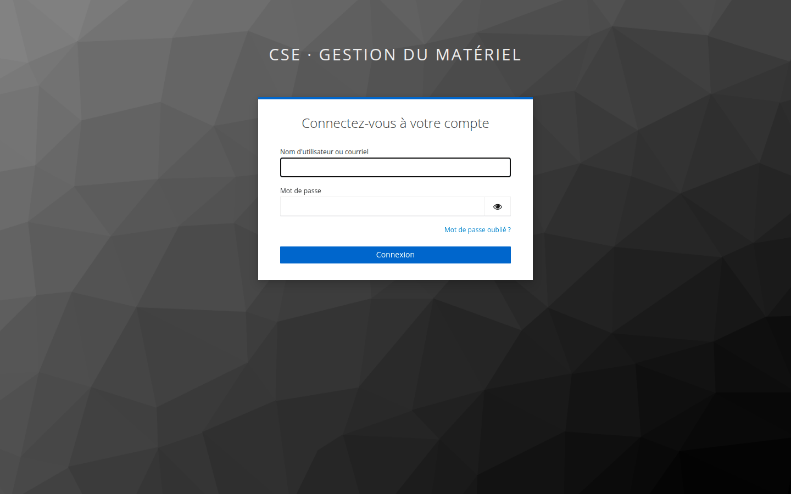

La session expire après une heure d'inactivité. Le bouton portant vos initiales et votre nom (en haut à
droite) donne accès à **Mon profil** et à la **déconnexion**.

### 1.2 L'écran principal

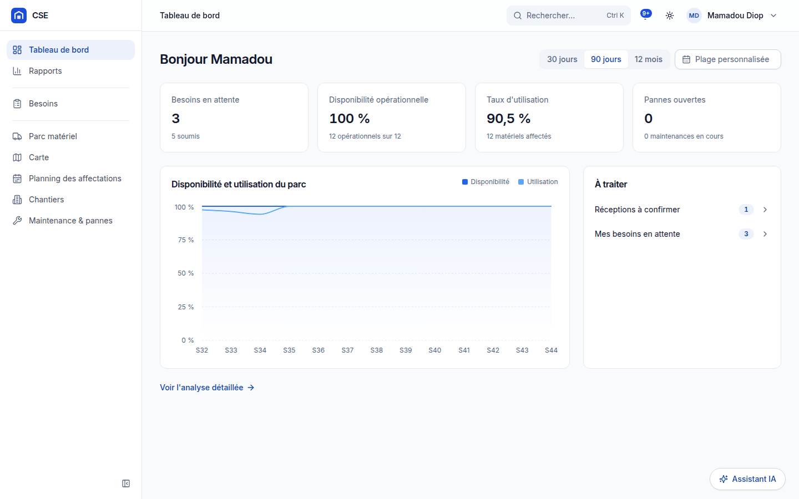

- **Menu de gauche** : seuls les écrans autorisés pour votre rôle apparaissent, regroupés par thème
  (pilotage, besoins, parc & chantiers, achats, finance, administration) et séparés par un trait fin. Le
  bouton en bas réduit le menu.
- **Recherche** (`Ctrl` + `K`, ou la barre « Rechercher… ») : ouvre une palette pour aller à un écran ou
  lancer une action rapide.
- **Cloche** : notifications non lues (mise à jour en temps réel). **Soleil/lune** : thème clair ou sombre.
- **Assistant IA** (bouton bleu en bas à droite) : poser une question en français sur le parc, les
  besoins, les chantiers ou les achats.
- **Tableau de bord** : volontairement épuré, il présente **4 indicateurs clés** de votre rôle, **un
  graphique** et la liste **À traiter** (actions qui vous attendent, avec leur nombre ; un clic ouvre la
  liste correspondante). La période se choisit en haut à droite : 30 jours, 90 jours (par défaut), 12 mois
  ou une plage personnalisée. Le lien **Voir l'analyse détaillée** ouvre la page **Rapports** pour
  l'ensemble des graphiques et tableaux.

| Palette de commandes (`Ctrl` + `K`) | Assistant IA |
|---|---|
| 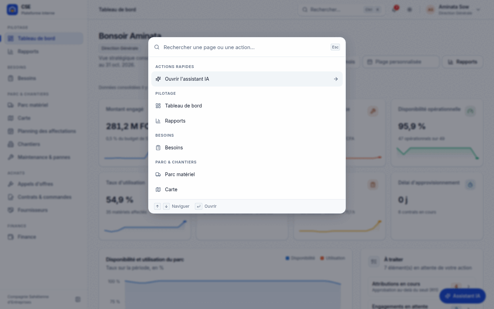 | 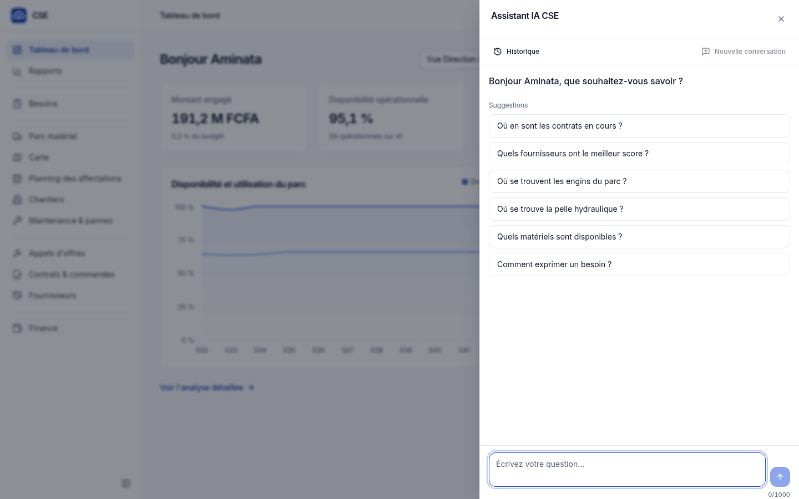 |

### 1.3 Listes, filtres et mobile

Les principales listes s'ouvrent sur des **onglets de statut** avec leur compteur (par exemple Tous / En
attente / En achat / Affectés / Rejetés pour les besoins). La barre au-dessus du tableau garde la recherche
et le filtre le plus utile ; les critères secondaires sont regroupés dans le bouton **Filtres**. Les listes se
trient en cliquant sur l'en-tête des colonnes signalées par une flèche et se paginent (20 lignes par défaut,
10 ou 50 au choix). Le bouton **Colonnes** masque ou affiche des colonnes. Un clic sur une ligne ouvre la
fiche détaillée ; l'action principale y est un bouton en haut à droite, et les actions secondaires d'une
fiche matériel (ou d'une ligne utilisateur) sont rangées dans le menu **« … »**.

Sur téléphone, le menu s'ouvre par le bouton en haut à gauche et les tableaux deviennent des cartes :

| Tableau de bord sur mobile | Liste des besoins sur mobile | Mode sombre (mobile) |
|---|---|---|
| 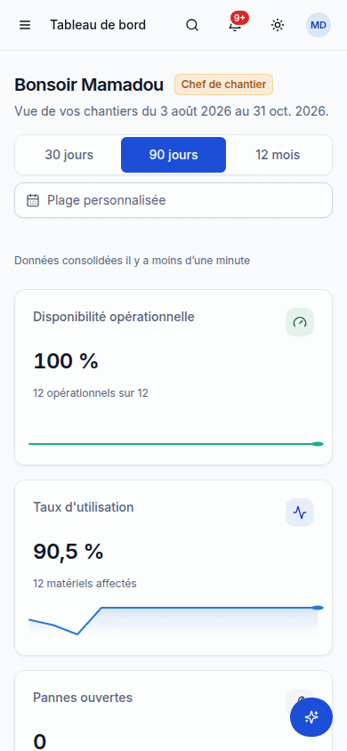 | 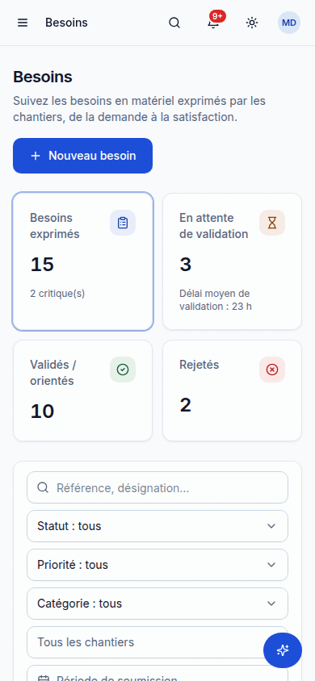 | 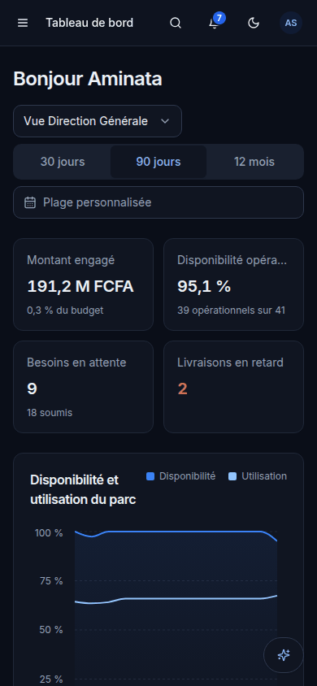 |

### 1.4 Notifications

La page **Notifications** (cloche → « Tout voir ») liste les messages qui vous sont destinés ou destinés à
votre rôle (besoin validé, réception à confirmer, engagement à valider…). Un clic ouvre l'élément concerné ;
**Tout marquer comme lu** vide le compteur. Certaines notifications sont aussi envoyées par e-mail.

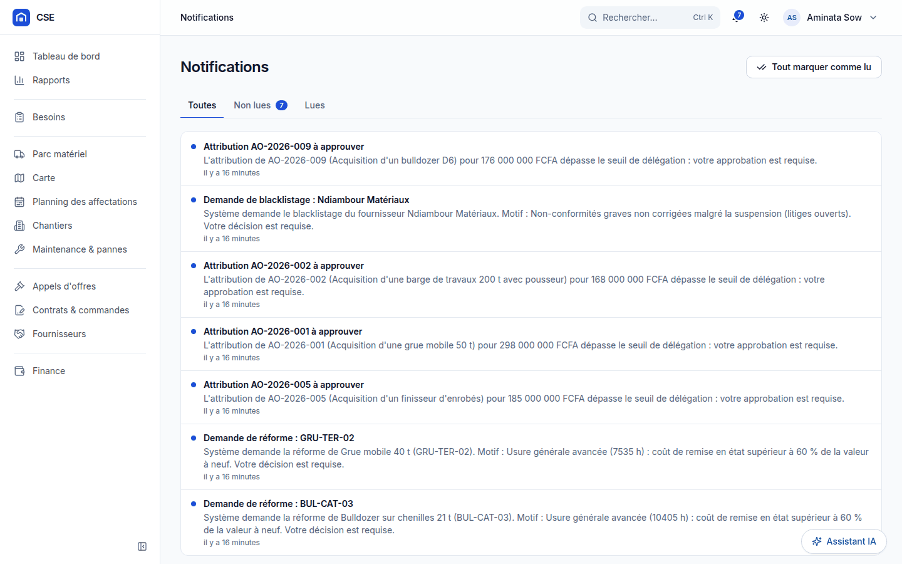

---

## 2. Chef de chantier

Vous voyez uniquement **vos chantiers**, leurs matériels et vos besoins.

### 2.1 Exprimer un besoin en matériel

1. Menu **Besoins** → bouton **Nouveau besoin**.
2. Choisir la **catégorie** (matériel roulant, outillage, équipement informatique, consommable), saisir la
   **désignation**, la **quantité** et la **durée d'utilisation** (jours), et si besoin les spécifications.
3. Choisir le **chantier** (parmi les vôtres) et la **date souhaitée**.
4. Choisir la **priorité**. Pour **Urgent** ou **Critique**, la **justification est obligatoire** (règle R08).
5. **Envoyer le besoin**. Il reçoit une référence (`BES-2026-0042`) et le statut **En attente** ; le Responsable
   Matériel est notifié.

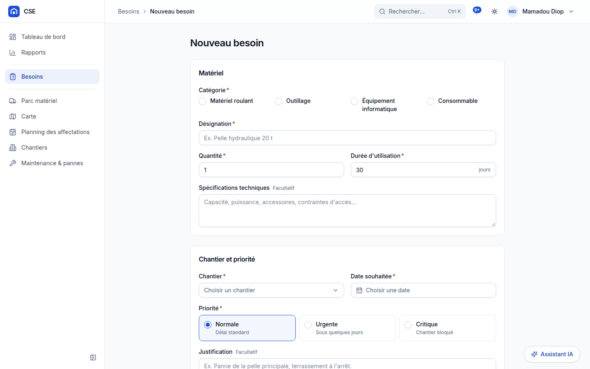

### 2.2 Suivre ses besoins

Menu **Besoins** : les onglets **Tous**, **En attente**, **En achat**, **Affectés** et **Rejetés** (avec leur
compteur) trient vos besoins ; la recherche et le filtre de priorité restent visibles, les autres critères
(statut, catégorie, chantier, période de soumission) sont dans **Filtres**. La liste montre désignation,
chantier, priorité, statut et date. La fiche affiche l'avancement (Soumis → Validation → Orientation), les
informations du besoin, les matériels affectés et l'historique complet.

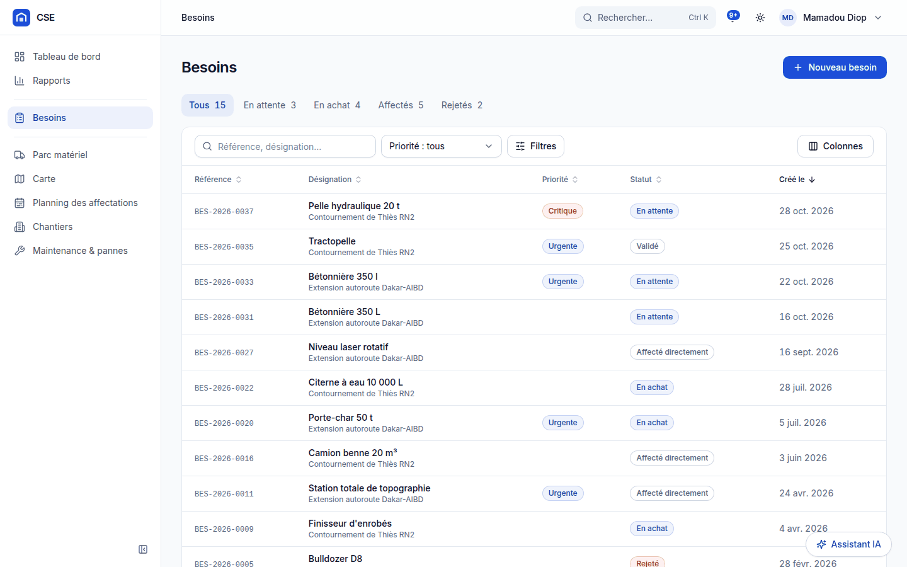

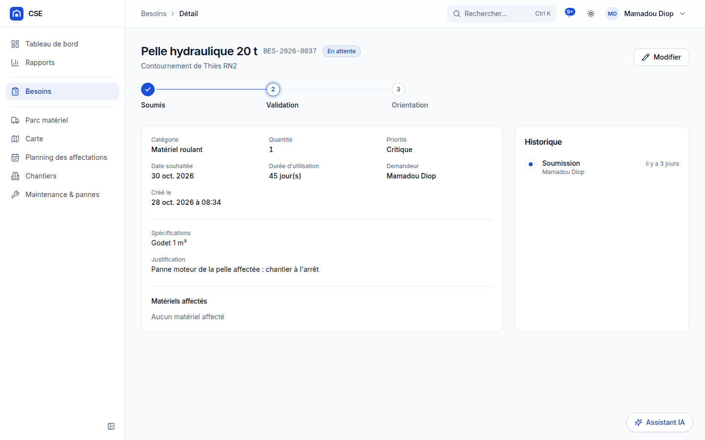

| Statut | Signification |
|---|---|
| En attente | en cours d'examen par le Responsable Matériel ; **modifiable** par vous (bouton **Modifier**) |
| Validé | accepté, orientation en cours (plus modifiable : règle R05) |
| Affecté directement | des engins du parc vous sont affectés |
| En achat | transmis au service Achats |
| Rejeté | refusé, le motif est affiché dans la fiche |

### 2.3 Confirmer la réception d'un matériel

Quand un engin est affecté à votre chantier (depuis le parc ou après une livraison fournisseur), il apparaît
dans **À traiter → Réceptions à confirmer** du tableau de bord.

1. Ouvrir l'élément, puis la fiche du matériel.
2. Bouton **Confirmer la réception**, saisir d'éventuelles observations (état, compteur), confirmer.
3. Le matériel passe à l'état **Affecté** sur votre chantier ; la réception est tracée.

### 2.4 Parc de vos chantiers, compteur et pannes

- **Parc matériel** : engins présents sur vos chantiers, état, prochaine maintenance. **Carte** et
  **Planning des affectations** montrent la localisation et l'occupation dans le temps.
- Fiche d'un matériel → menu **« … »** → **Relevé d'heures** pour saisir le compteur horaire.
- **Signaler une panne** : menu **Maintenance & pannes** → bouton **Signaler une panne** (ou depuis la
  fiche du matériel) ; choisir le matériel, la **gravité** (mineure, majeure, bloquante) et décrire le
  problème. Une panne bloquante alerte immédiatement le Responsable Matériel.

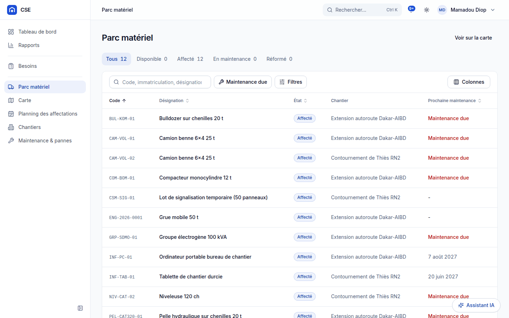

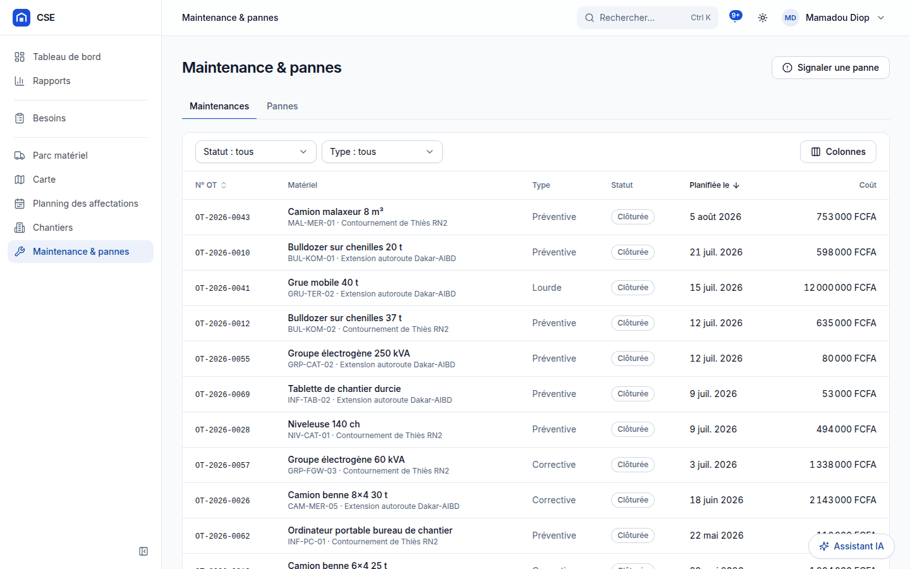

---

## 3. Responsable Matériel

### 3.1 Valider ou rejeter les besoins (R01)

1. Menu **Validation** : la **file d'attente** classe les besoins du plus prioritaire au plus ancien.
2. **Valider** : l'écran indique combien d'engins disponibles correspondent. Ajouter un commentaire si utile,
   puis **Valider le besoin**. La plateforme oriente automatiquement :
   - parc suffisant → affectation directe des engins (le chef doit ensuite confirmer la réception) ;
   - parc insuffisant → **En achat** (le besoin apparaît dans les « besoins à acheter » du service Achats).
3. **Rejeter** : le **motif est obligatoire** ; il est communiqué au demandeur.

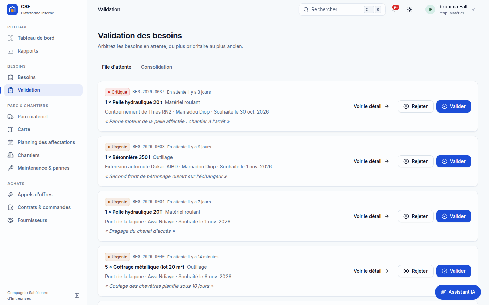

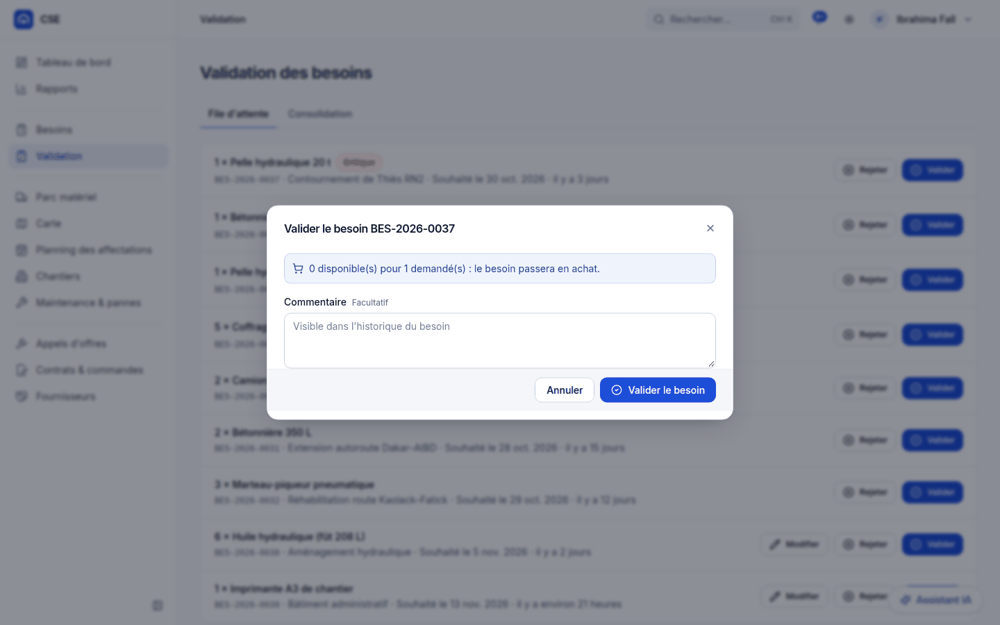

> Si le service de suivi du parc était momentanément indisponible, le besoin reste **Validé** avec la mention
> « Orientation en attente » : ouvrir la fiche et cliquer **Relancer l'orientation**.

L'onglet **Consolidation** regroupe les demandes similaires (même catégorie et désignation) pour mutualiser
les commandes et signale les **doublons potentiels**.

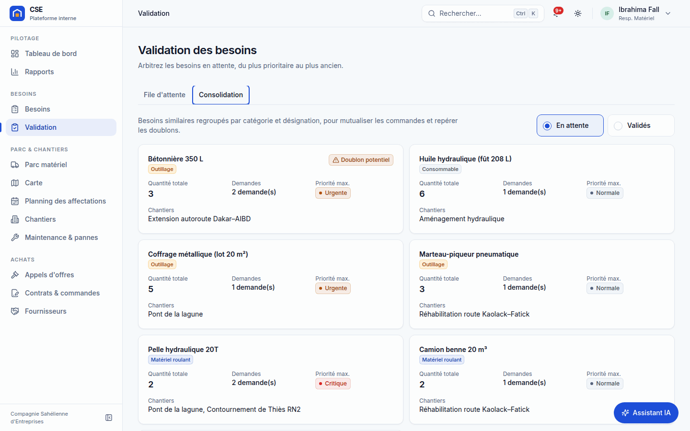

### 3.2 Gérer le parc

- **Parc matériel** : onglets par état (**Tous**, **Disponible**, **Affecté**, **En maintenance**,
  **Réformé**), bouton **Maintenance due**, autres critères dans **Filtres**. **Nouveau matériel** pour en
  ajouter un (code, désignation, catégorie, type d'engin, tarif journalier, valeur d'acquisition).
- Fiche matériel : synthèse (type, marque, immatriculation, heures, maintenance, tarif, valeur), onglets
  **Affectations**, **Maintenances**, **Pannes**, **Mouvements** ; bouton **Affecter** et menu **« … »**
  (Libérer, Relevé d'heures, Mettre en maintenance, Signaler une panne, Modifier la fiche, Demander la
  réforme).

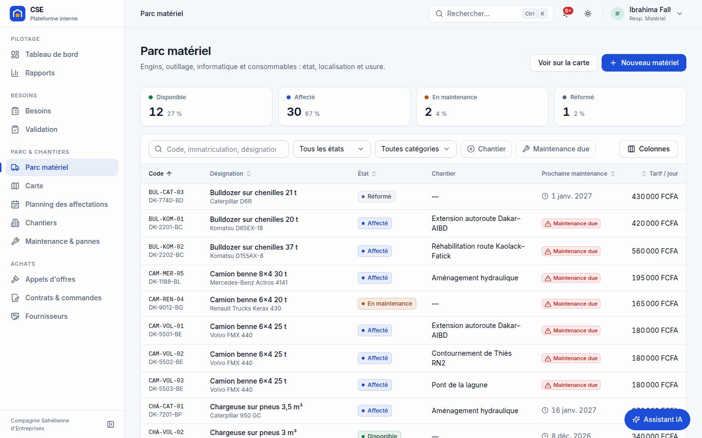

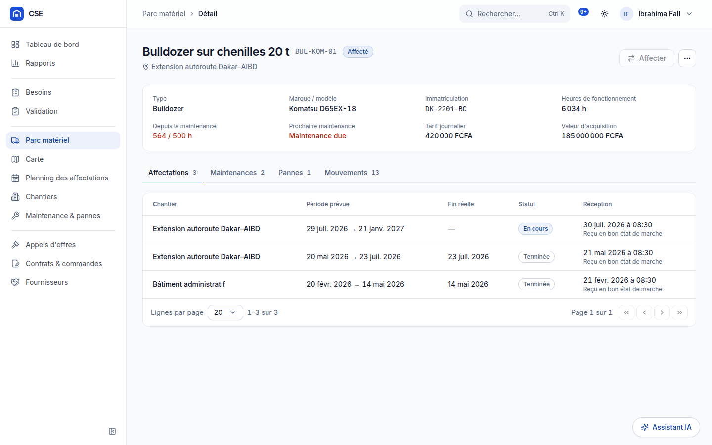

### 3.3 Affecter un matériel à un chantier (R04)

Depuis la fiche (**Affecter**) ou le **Planning des affectations** (**Affecter un matériel**, ou clic sur un
créneau libre) : choisir le chantier et la période. Seul un matériel **Disponible** est affectable et deux
affectations ne peuvent pas se chevaucher (message « Conflit d'affectation »). **Libérer** termine
l'affectation et rend le matériel disponible.

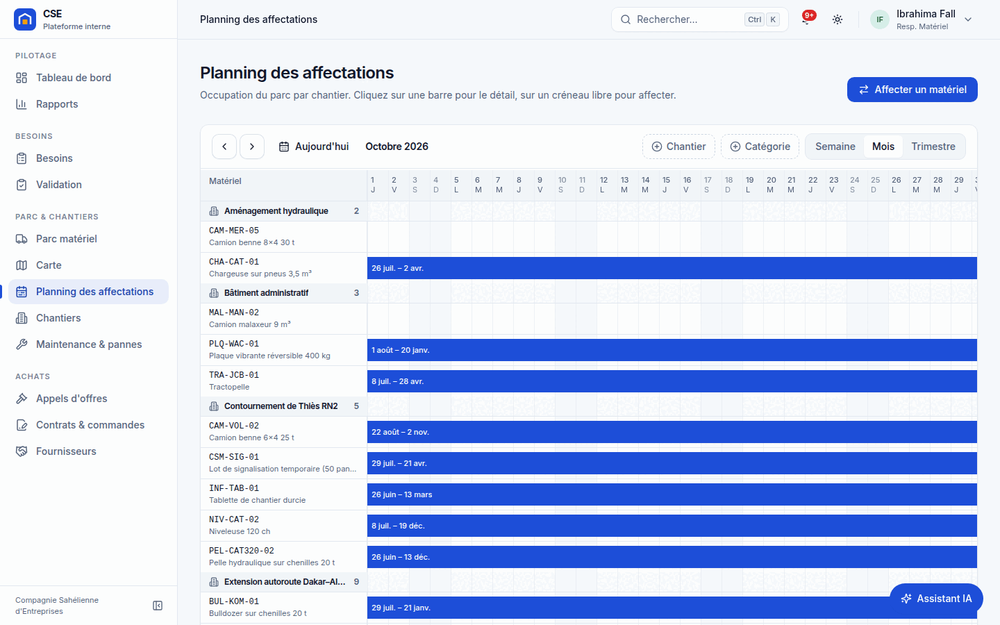

La **Carte** situe chantiers et engins (pastilles par état) ; la liste de droite permet d'ouvrir chaque
chantier.

| Carte (clair) | Carte (sombre) |
|---|---|
| 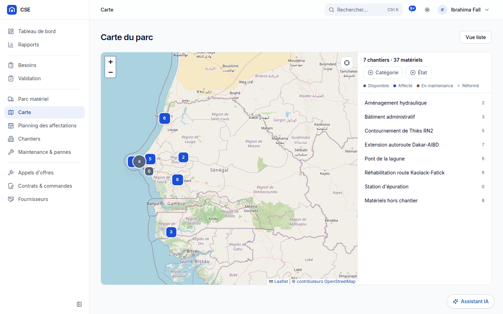 | 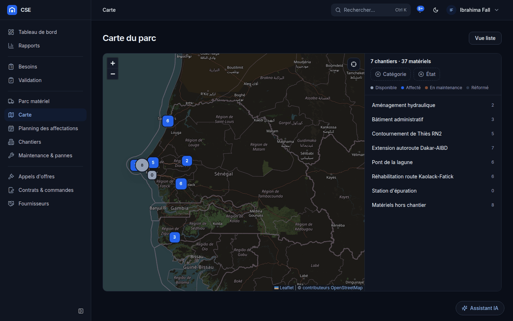 |

### 3.4 Maintenance et pannes

Menu **Maintenance & pannes** :

1. **Planifier une maintenance** (préventive, corrective ou lourde) : matériel, description, date, technicien.
   Un ordre de travail `OT-2026-NNNN` est créé. Depuis l'onglet **Pannes**, **Créer un OT** rattache l'ordre à
   une panne signalée.
2. **Démarrer** l'OT : le matériel passe **En maintenance**.
3. **Clôturer l'OT** : saisir le **coût**, les observations et le compteur ; le matériel redevient
   **Disponible** (ou **Affecté** s'il avait une affectation en cours).

Les alertes de maintenance préventive (seuils d'heures ou de jours du type d'engin) arrivent chaque matin
dans les notifications.

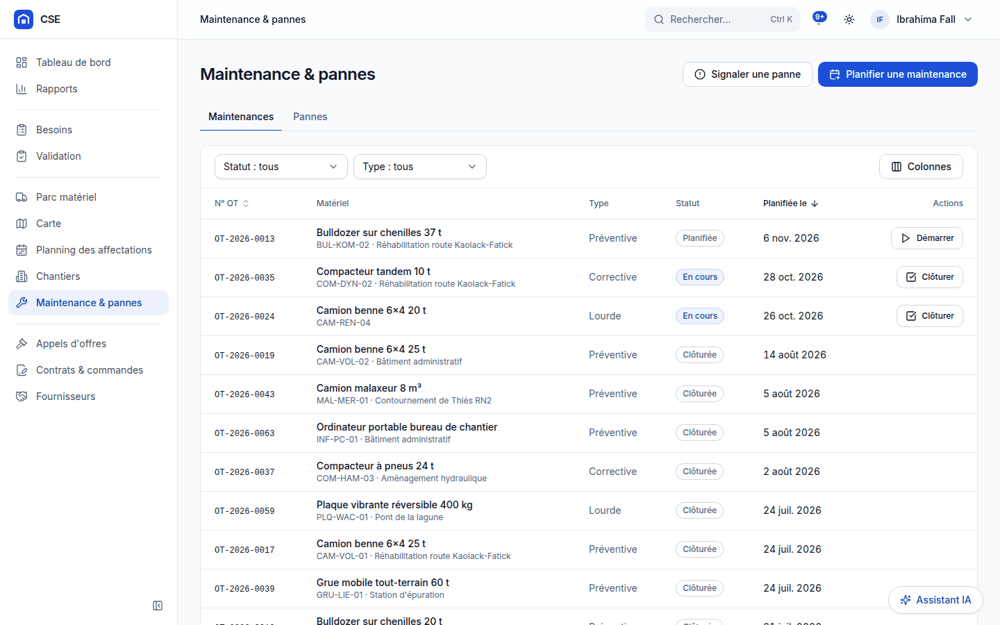

### 3.5 Réforme d'un matériel (R13)

Fiche matériel → menu **« … »** → **Demander la réforme**, motif obligatoire. Le matériel doit être libéré et
hors maintenance. La Direction Générale décide ; une fois réformé, l'engin ne peut plus être affecté.

### 3.6 Chantiers

Menu **Chantiers** : **Nouveau chantier** (code, nom, localisation, région, coordonnées, budget, montant du
marché, dates, chef) et modification. **Terminer** un chantier n'est possible que lorsqu'aucun matériel n'y
est encore affecté.

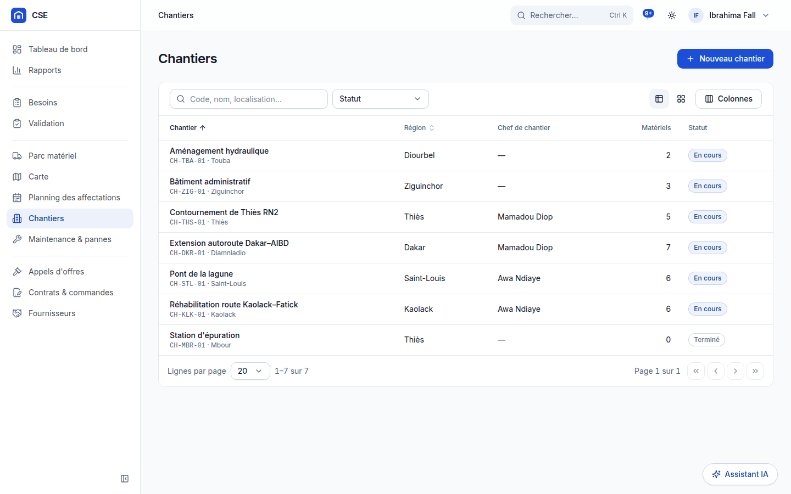

### 3.7 Participation aux achats

- **Co-valider** chaque proposition d'attribution d'un marché (fiche de l'appel d'offres → onglet
  **Attribution**, règle R11).
- **Noter** les offres (qualité technique, garantie, SAV, références) dans l'onglet **Évaluation**.
- **Évaluer** un fournisseur après une livraison et **Ouvrir un litige**.

---

## 4. Responsable des Achats

### 4.1 Lancer un appel d'offres

1. Menu **Appels d'offres** → **Lancer un appel d'offres**, ou onglet **Besoins à lancer** (besoins passés
   en achat sans appel d'offres, avec leur compteur) → **Lancer un AO** sur la ligne du besoin.
2. Renseigner objet, type (appel d'offres ou demande de prix), catégorie, quantité, spécifications, budget
   estimé, **date et heure limite**.
3. Pondérer les **critères** (prix, délai, qualité technique, garantie, SAV, références : total 100 %).
4. Choisir les **fournisseurs invités** : seuls les fournisseurs **actifs** de la spécialité sont proposés (R14).
5. **Publier l'appel d'offres** : référence `AO-2026-NNN`, statut **Publié**.

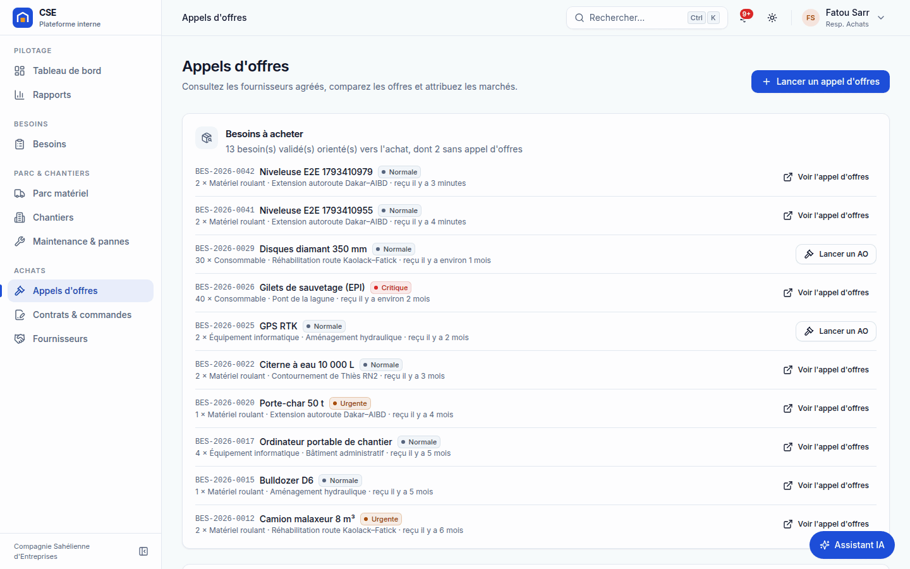

### 4.2 Recevoir et évaluer les offres

La fiche d'un AO présente une synthèse (budget, quantité, chantier, date limite, offres reçues, besoin
d'origine) ; **Détails** déplie la description, les critères pondérés et les fournisseurs invités.

- Onglet **Offres** : les offres déposées par les fournisseurs sur le portail (§8.3) y arrivent d'elles-mêmes ;
  **Saisir une offre reçue** sert aux offres arrivées hors portail, avant la date limite (R02).
  Tant que l'AO est publié, les offres sont **anonymisées** (codes `OFR-…`, règle R10).
- **Clôturer** l'AO (automatique à la date limite) : l'anonymat est levé.
- Onglets **Évaluation** et **Comparatif** (visibles une fois l'AO clôturé) : saisir les notes ; prix et
  délai sont calculés automatiquement. Le **Comparatif** classe les offres par score pondéré.

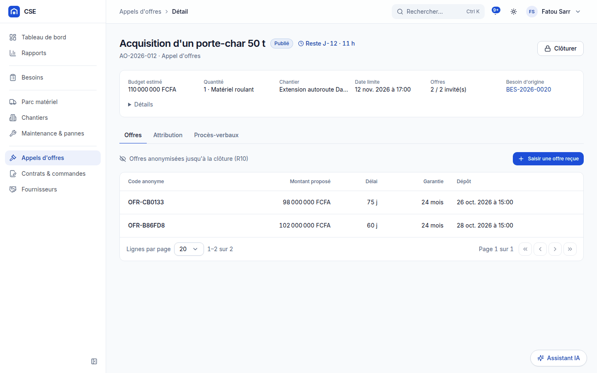

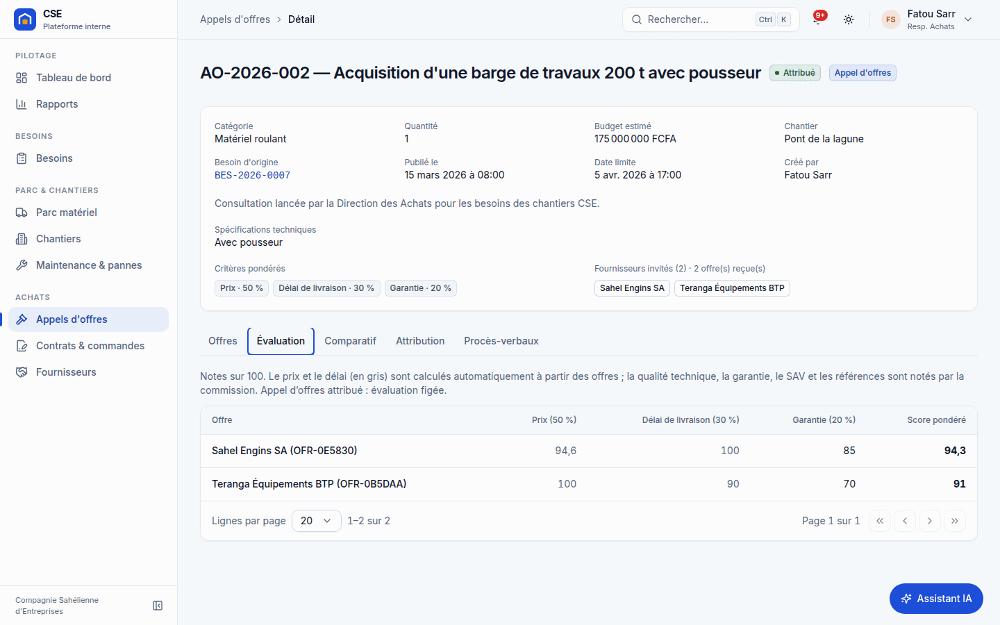

### 4.3 Attribuer le marché (R11)

Onglet **Attribution** : choisir l'offre, justifier, **Proposer l'attribution**. Le Responsable Matériel
co-valide ; au-delà du seuil de délégation (150 000 000 FCFA), la Direction Générale approuve aussi. Une fois
toutes les approbations obtenues, l'AO passe **Attribué** et un **contrat brouillon** est généré (lien
**Voir le contrat**). L'onglet **Procès-verbaux** permet de **Télécharger le PDF** d'ouverture et d'évaluation.

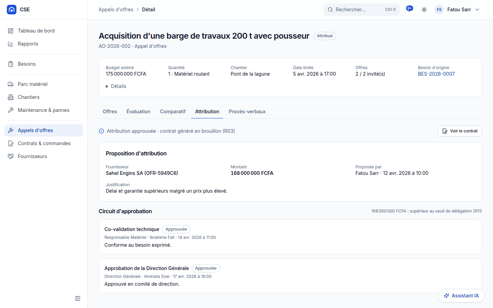

### 4.4 Exécuter le contrat

Menu **Contrats & commandes** → fiche du contrat ; la frise montre Brouillon → En attente du fournisseur →
Signé → Engagement validé → En livraison → Livré → Clôturé. L'action suivante est le bouton principal en haut
de la fiche ; une ligne bleue indique ce que l'on attend des autres acteurs. La synthèse affiche les deux
signatures (CSE et fournisseur, nom et date) et, le cas échéant, l'expédition déclarée par le fournisseur.
Les onglets **Clauses contractuelles**, **Jalons** et **Engagement budgétaire** détaillent le contrat.

1. Compléter les **clauses** (garantie, pénalité de retard, jalons) puis **Signer et envoyer au
   fournisseur** : la confirmation rappelle que le fournisseur doit **contresigner** sur son portail. Le
   contrat passe **En attente du fournisseur** (« En attente de la signature du fournisseur ») ; les clauses
   ne sont plus modifiables.
2. Le fournisseur signe sur le portail : le contrat passe **Signé** et la demande d'engagement part à la DAF
   (« En attente de la validation de l'engagement par le DAF »). S'il **refuse**, le contrat revient en
   **Brouillon** et la fiche affiche son **motif de refus** en rouge : renégocier, ajuster les clauses puis
   signer à nouveau.
3. Après validation de l'engagement (R06), la fiche indique « En attente de l'expédition par le
   fournisseur » : c'est le fournisseur qui **déclare l'expédition** sur le portail (date et commentaire
   visibles dans la synthèse), le contrat passe **En livraison**. Si le fournisseur ne peut pas utiliser le
   portail, le menu **…** propose **Démarrer la livraison (hors portail)**.
4. À réception : **Confirmer la livraison** (date réelle, numéro de bon de livraison). Les matériels sont
   créés automatiquement dans le parc et affectés au chantier du besoin ; le chef confirme ensuite la
   réception. Les retards sont signalés et les pénalités calculées. Le fournisseur peut alors déposer sa
   facture sur le portail.
5. **Clôturer le contrat** une fois toutes les factures payées.

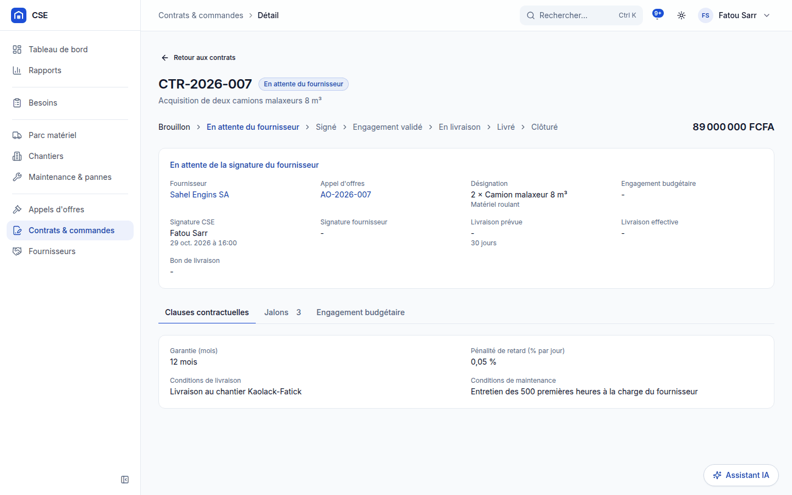

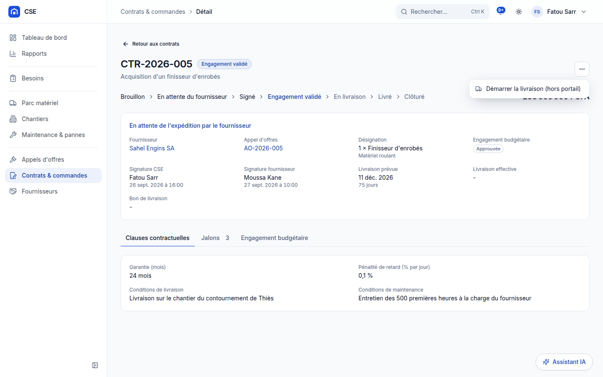

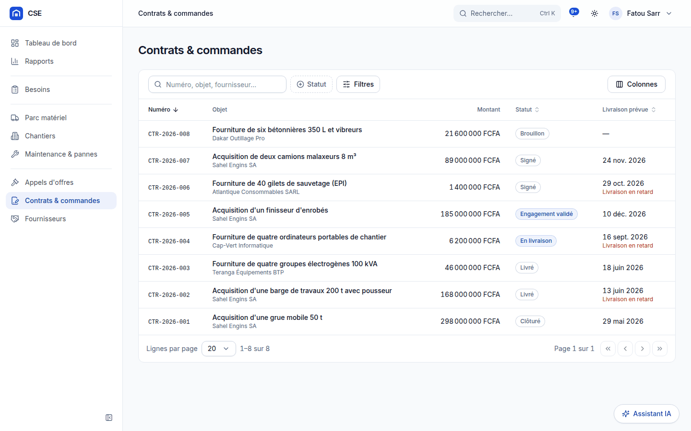

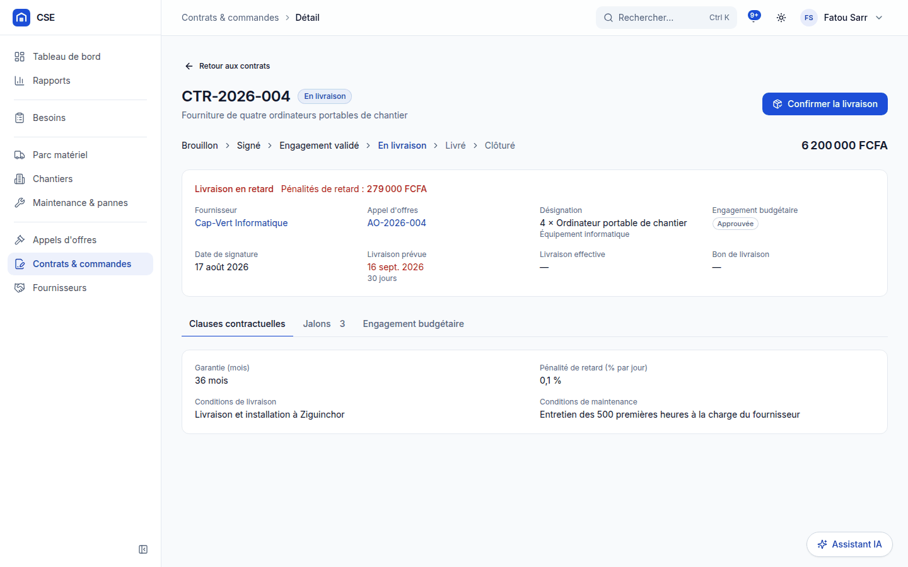

### 4.5 Fournisseurs

Menu **Fournisseurs** : onglets **Liste** (sous-onglets Tous, Actifs, À valider, Suspendus, Blacklistés),
**Classement** (score de performance), **Comparaison de prix** (prix min., moyen et max. par article du
catalogue).
**Nouveau fournisseur** pour l'enregistrer. Dans la fiche : informations légales, contact, coordonnées
bancaires (visibles du RA et de la DAF seulement), documents administratifs (alerte si expirés),
évaluations, catalogue, litiges ; actions **Valider l'inscription**, **Suspendre**, réactiver,
**Demander le blacklistage** (fournisseur suspendu uniquement, décision de la Direction Générale, R09).

**Inscriptions du portail** : un fournisseur qui s'inscrit lui-même sur le portail (§8.1) apparaît dans le
sous-onglet **À valider** (statut « En attente de validation »). Ouvrir sa fiche, vérifier NINEA, contact et
spécialités, puis **Valider l'inscription** : le fournisseur devient **Actif** (invitable aux appels
d'offres), un compte portail est créé avec son e-mail comme identifiant, et un message confirme qu'**un
e-mail lui a été envoyé pour définir son mot de passe** (visible dans MailHog en démonstration).

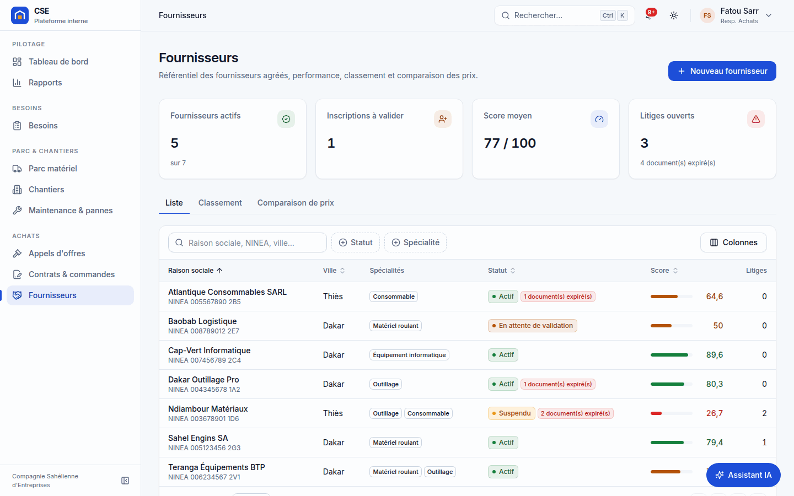

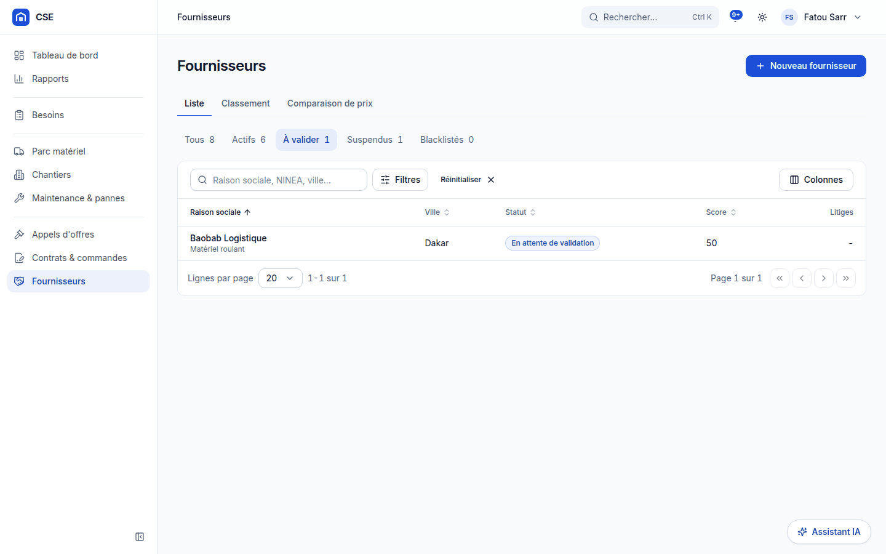

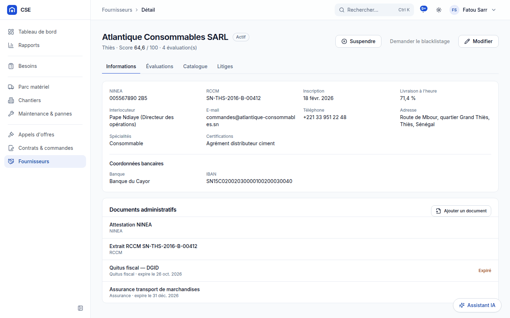

| Classement | Comparaison de prix |
|---|---|
| 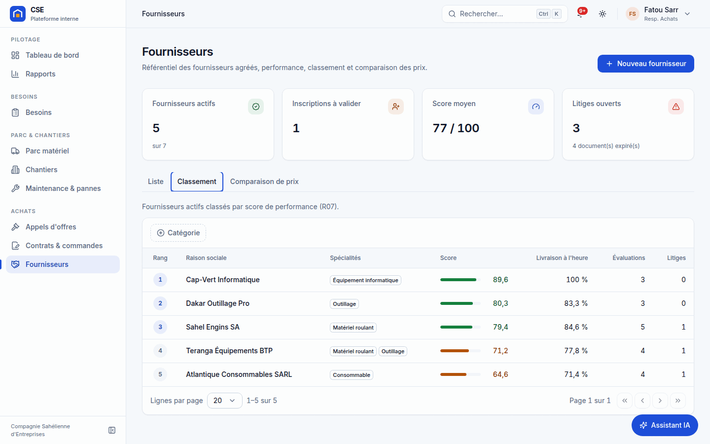 |  |

### 4.6 Factures

Les fournisseurs déposent eux-mêmes leurs factures sur le portail (§8.5), une fois le contrat livré. Le RA
est autorisé par l'API à enregistrer et consulter les factures, mais l'écran **Finance** n'est ouvert qu'à la
DAF et à la Direction Générale : une facture reçue hors portail est donc saisie par la DAF (§5.2).

---

## 5. Direction Administrative et Financière (DAF)

### 5.1 Valider les engagements (R06)

Menu **Finance** → onglet **Engagements à valider** : pour chaque contrat **signé par la CSE et par le
fournisseur**, **Valider** ou **Refuser** (commentaire). L'engagement n'apparaît qu'après la contresignature
du fournisseur. Sans engagement validé, le fournisseur ne peut pas déclarer l'expédition.

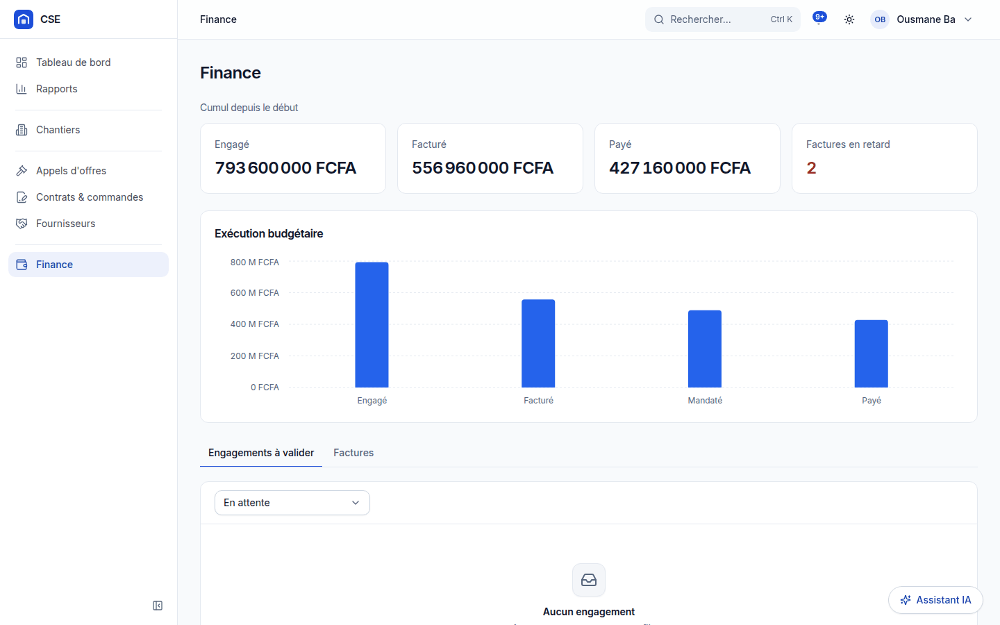

### 5.2 Traiter les factures

Onglet **Factures** : les factures déposées par les fournisseurs sur le portail arrivent au statut **Reçue** ;
**Enregistrer une facture** sert aux factures reçues hors portail. Pour chaque facture : **Mandater**
(référence du mandat), **Payer** ou **Rejeter** (motif transmis au fournisseur, visible sur son portail).
Les factures dont l'échéance est dépassée sont signalées « en retard ».

### 5.3 Pilotage financier

- **Tableau de bord DAF** (sur la période choisie) : montant engagé, montant payé (et mandaté), coût de
  maintenance, livraisons en retard, graphique d'exécution budgétaire et **À traiter** (engagements à
  valider, factures en retard).
- **Finance** : les totaux **Engagé**, **Facturé**, **Payé** et **Factures en retard** sont des **cumuls
  depuis le début** (mention « Cumul depuis le début »), indépendants de la période du tableau de bord, suivis
  du graphique Engagé / Facturé / Mandaté / Payé.

Les montants sont en FCFA.

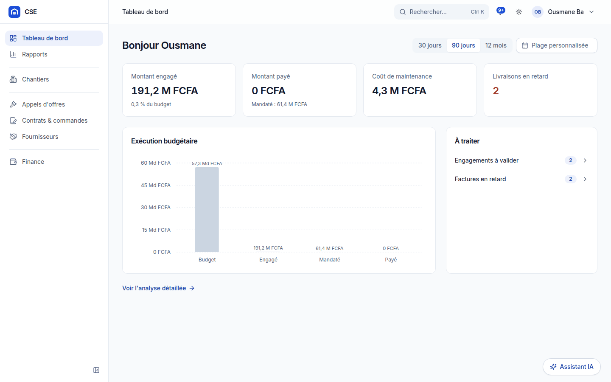

---

## 6. Direction Générale

La Direction Générale consulte tout en **lecture seule** (règle R12) et n'intervient que pour trois
décisions.

### 6.1 Tableaux de bord et rapports

- **Tableau de bord** : sélecteur de vue (Direction Générale, DAF, Achats, Matériel) et période ; la vue
  Direction Générale montre 4 indicateurs (montant engagé, disponibilité opérationnelle, besoins en attente,
  livraisons en retard), le graphique de disponibilité et d'utilisation du parc et la liste **À traiter**
  (attributions en cours, engagements en attente, besoins critiques). **Voir l'analyse détaillée** ouvre les
  Rapports.
- **Rapports** : l'analyse complète, graphiques (parc par catégorie, besoins par priorité, exécution
  budgétaire, meilleurs fournisseurs) puis synthèse chiffrée par section (parc, besoins, achats,
  fournisseurs, finances, chantiers), filtrable par vue, période et chantier ; **Exporter en PDF** ou
  **Exporter en Excel**.

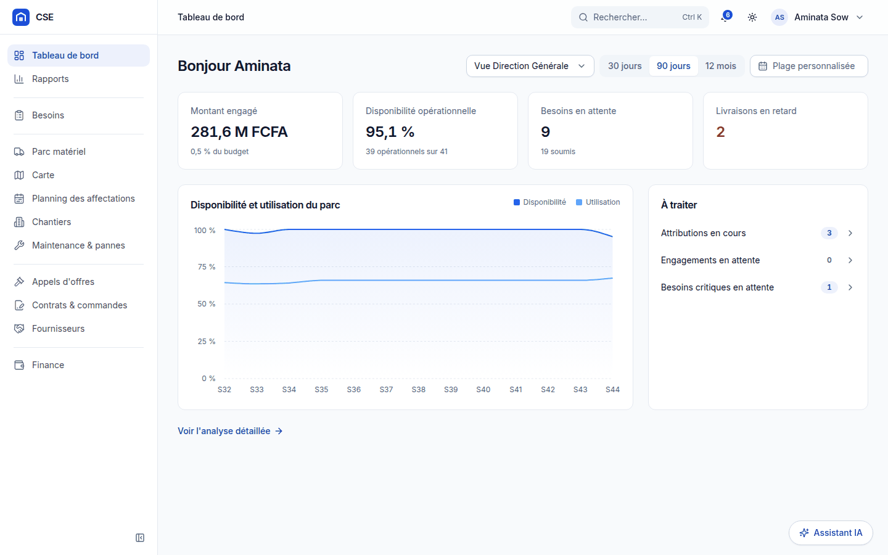

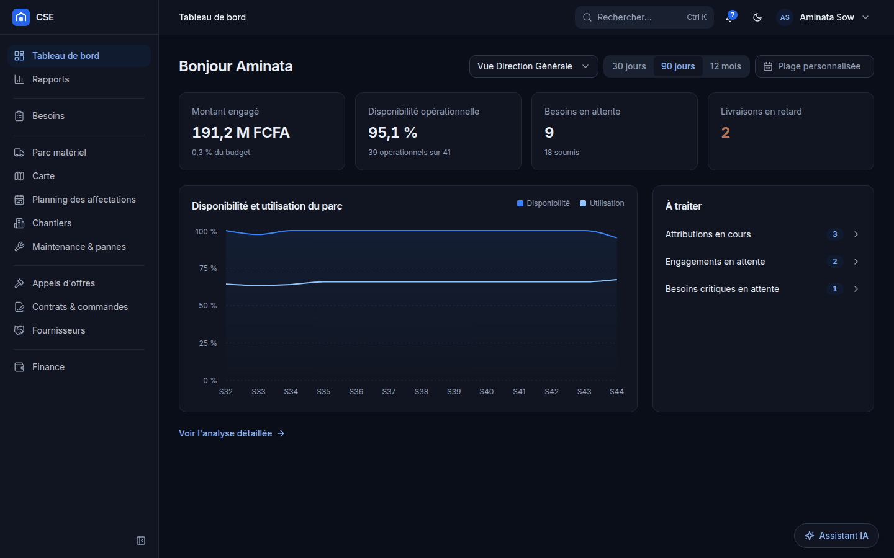

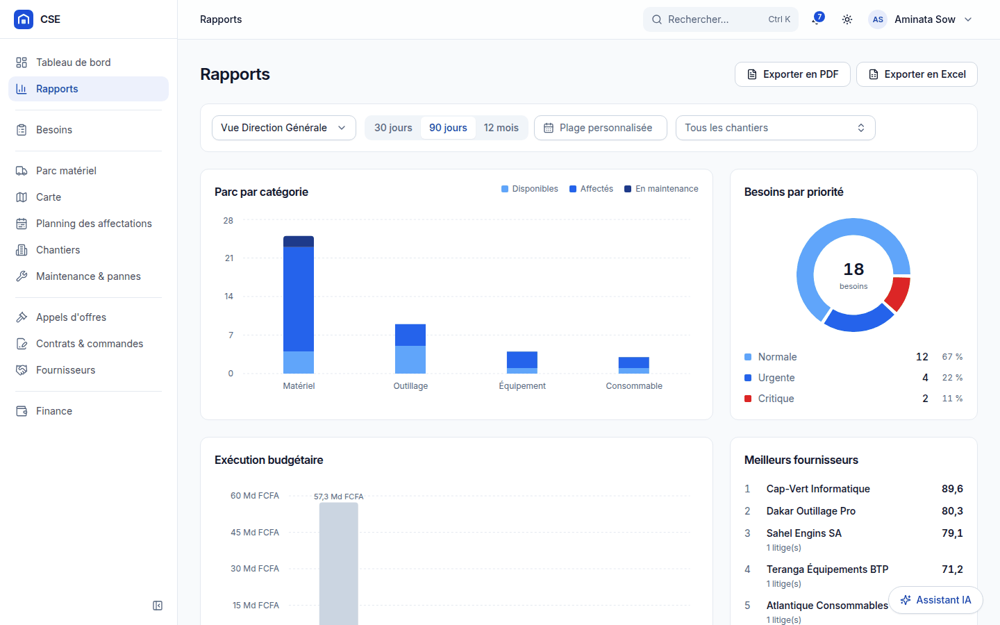

### 6.2 Décisions réservées

| Décision | Où | Règle |
|---|---|---|
| Approuver ou refuser une **attribution** de marché au-delà du seuil de délégation | Appels d'offres → fiche → **Attribution** → **Approuver** / **Refuser** | R11 |
| Approuver ou refuser un **blacklistage** de fournisseur | Fournisseurs → fiche → **Approuver le blacklistage** / **Refuser le blacklistage** | R09 |
| Décider de la **réforme** d'un matériel | Parc matériel → fiche → **Décider de la réforme** → **Approuver la réforme** / **Refuser** | R13 |

Ces demandes apparaissent dans **À traiter** et dans les notifications.

---

## 7. Administrateur système

### 7.1 Utilisateurs

Menu **Utilisateurs** : onglets par rôle (avec compteur), filtre de statut ; les actions sur un compte sont
dans le menu **« … »** de sa ligne.

1. **Nouvel utilisateur** : prénom, nom, e-mail, téléphone, **rôle** (un seul) et attributs du rôle
   (chantiers rattachés pour un chef, périmètre du parc, budget géré…). Un **mot de passe temporaire** est
   généré (bouton **Générer un mot de passe**, **Copier le mot de passe**) : le communiquer par un canal sûr.
   L'utilisateur devra le changer, et configurer l'OTP pour les rôles sensibles.
2. Modifier un compte (y compris changer son rôle), **Désactiver** / réactiver, **Réinitialiser le mot de
   passe**. Un administrateur ne peut pas agir sur son propre compte.

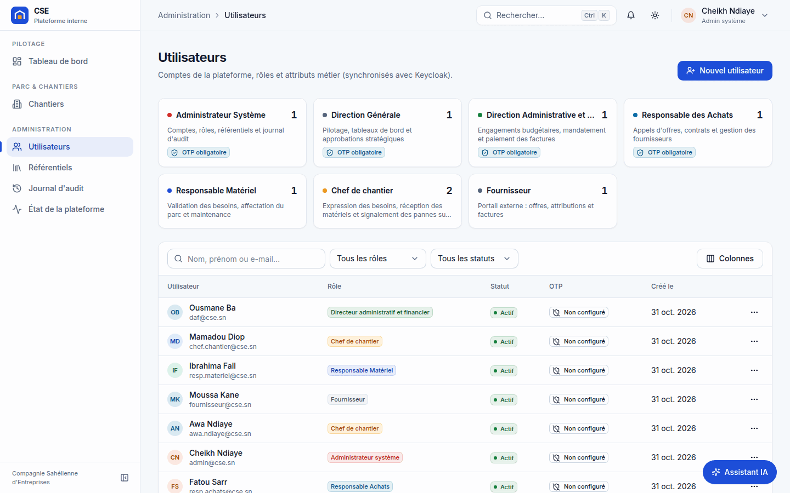

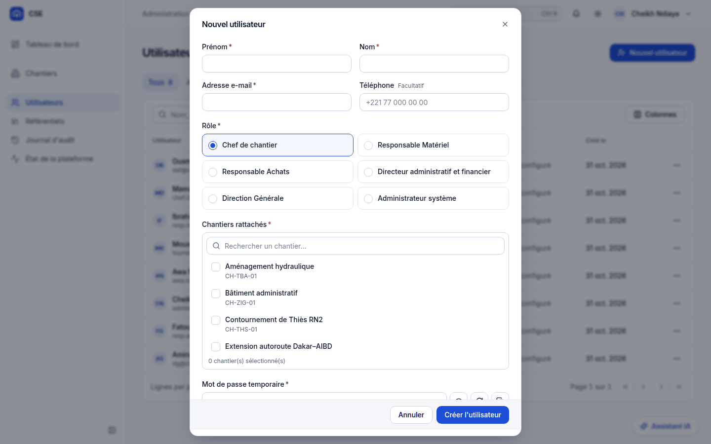

### 7.2 Référentiels

Menu **Référentiels** : types d'engins (**Nouveau type d'engin** : code, libellé, catégorie, seuils de
maintenance en heures et en jours, actif). Ces seuils déclenchent les alertes de maintenance préventive.

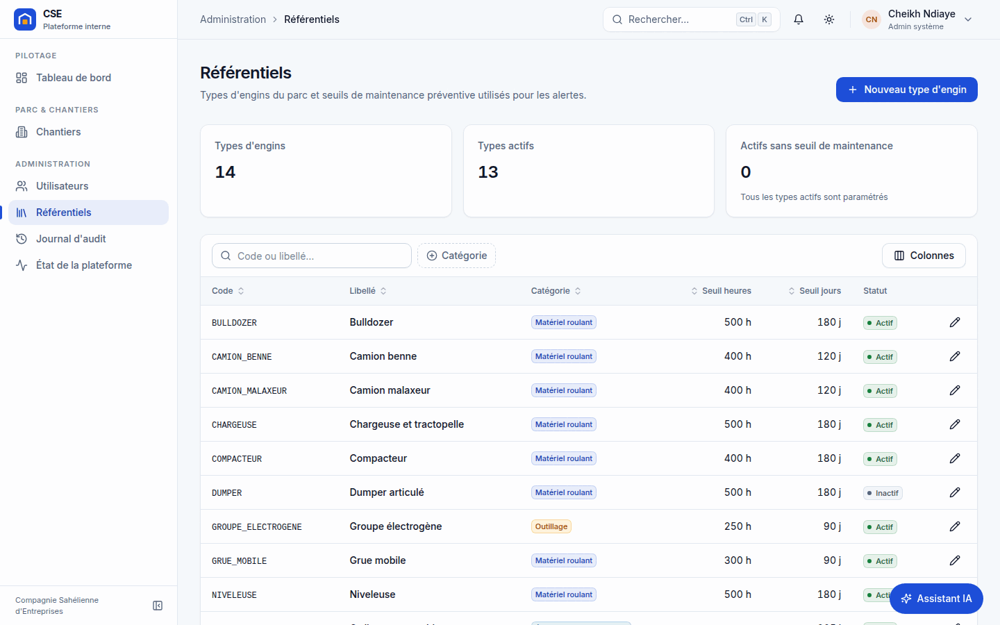

### 7.3 Journal d'audit

Menu **Journal d'audit** : toutes les actions métier de la plateforme (qui, quoi, quand, sur quelle entité),
avec trois compteurs (événements, aujourd'hui, 7 jours) ; recherche texte et filtre utilisateur visibles,
le service et la période dans **Filtres**. Le journal est **immuable**.

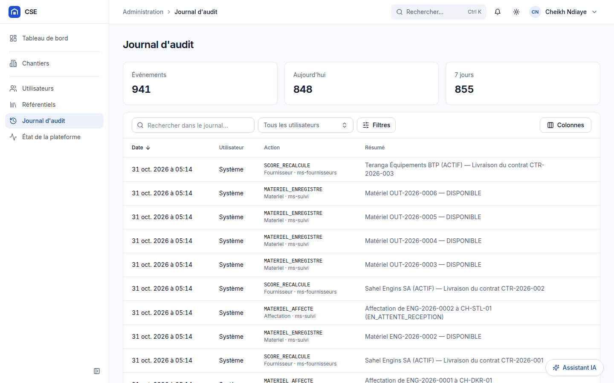

### 7.4 État de la plateforme

Menu **État de la plateforme** : disponibilité et temps de réponse de chaque service, actualisation
automatique toutes les 15 secondes.

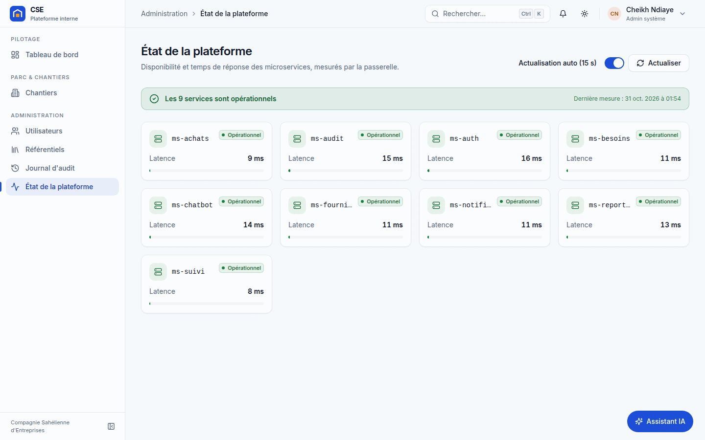

---

## 8. Portail fournisseur

Le portail (démonstration : http://localhost:5174) est l'application des **fournisseurs** de la CSE : ils y
déposent leurs offres, signent leurs contrats, déclarent leurs expéditions et déposent leurs factures. Il ne
montre au fournisseur que ses propres données. Compte de démonstration : `fournisseur@cse.sn` (Moussa Kane,
Sahel Engins SA), mot de passe `Cse@2026`.

### 8.1 S'inscrire

Page d'accueil du portail → **Inscrire mon entreprise** : raison sociale, NINEA, RCCM, adresse, ville, pays,
téléphone, **e-mail** (il deviendra l'identifiant de connexion), nom et fonction du contact, spécialités.
**Envoyer la demande** : la demande part au Responsable des Achats (statut « En attente de validation »).
Après validation (§4.5), le fournisseur reçoit un e-mail « définir votre mot de passe », puis se connecte
avec **Se connecter**. Un NINEA ou un e-mail déjà connu est refusé.

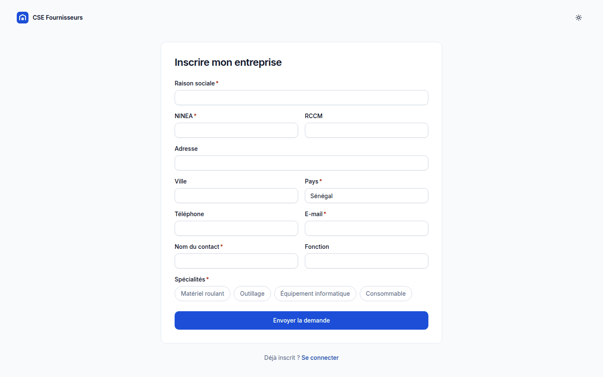

### 8.2 Accueil

Après connexion : quatre chiffres (offres en cours, contrats actifs, montant facturé, montant payé) et la
liste **À faire**, triée par urgence : contrat à signer, expédition à déclarer, facture rejetée, facture à
déposer, appel d'offres où déposer une offre (avec sa date limite). Un clic ouvre l'écran concerné.

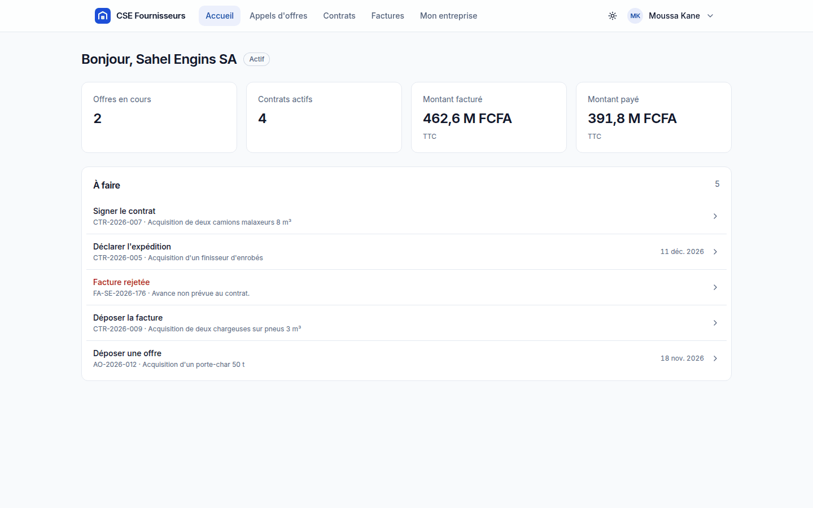

### 8.3 Appels d'offres

Menu **Appels d'offres** : onglet **Ouverts** (consultations ouvertes ou sur invitation, badge « Invité »,
compte à rebours jusqu'à la date limite) et onglet **Mes offres** (offres déposées, puis résultat « Retenue »
ou « Non retenue » une fois l'appel d'offres attribué). Dans la fiche : description, date limite, catégorie,
quantité, critères d'évaluation pondérés, puis **Déposer une offre** : montant proposé (FCFA), délai de
livraison (jours), garantie (mois), description. Une seule offre par appel d'offres, avant la date limite
(R02). Les offres restent anonymes pour la CSE jusqu'à la clôture (R10).

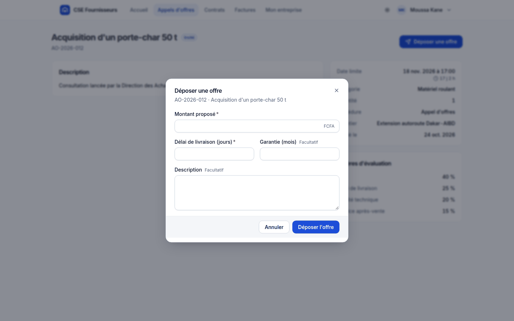

### 8.4 Contrats

Menu **Contrats** : onglets **À signer**, **En cours**, **Livrés**, **Clôturés**, **Tous**. La fiche montre
l'avancement (Signature, Engagement, Expédition, Livraison, Facturation, Clôture), les jalons, les clauses et
les montants.

- **Signer** : bouton **Signer le contrat** (contrat « À signer », déjà signé par la CSE). La confirmation
  rappelle la quantité, le montant et le délai. Le contrat passe « Signé » et l'engagement est soumis à la DAF.
- **Refuser** : menu **…** → **Refuser la signature**, avec un **motif obligatoire** (ex. pénalité trop
  élevée). Le contrat retourne au Responsable des Achats, qui voit le motif et renégocie.
- **Expédier** : une fois l'engagement validé par la DAF (contrat « À expédier »), **Déclarer l'expédition** :
  date d'expédition (aujourd'hui par défaut, ni future ni antérieure à la signature) et commentaire.
- **Jalons** : pendant la livraison, **Marquer atteint** sur chaque jalon (date de réalisation).
- **Facturer** : sur un contrat livré, **Déposer la facture** ouvre directement le formulaire de facture.

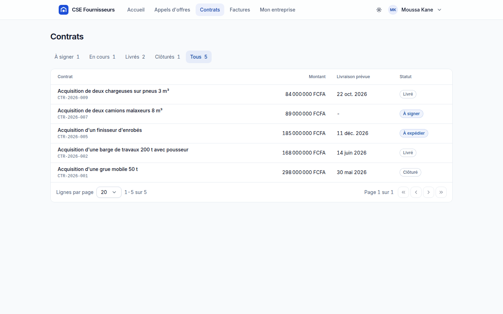

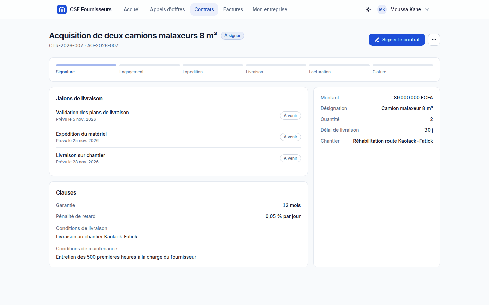

### 8.5 Factures

Menu **Factures** : compteurs **Toutes**, **Reçues**, **Mandatées**, **Payées**, **Rejetées** ; une facture
rejetée affiche le motif de la DAF, une facture payée sa date de paiement. **Nouvelle facture** : contrat livré,
numéro de facture, montant HT, taux de TVA (18 % par défaut), dates d'émission et d'échéance ; la TVA et le
total TTC sont calculés en direct. Le total ne peut pas dépasser le montant du contrat.

### 8.6 Mon entreprise

Menu **Mon entreprise** : onglet **Profil** (coordonnées modifiables par **Modifier**, spécialités,
certifications, banque, et la **performance** vue par la CSE : score sur 100, nombre d'évaluations,
livraisons à l'heure), onglet **Documents** (documents administratifs et leurs dates d'expiration), onglet
**Catalogue** (articles, prix unitaires et délais, utilisés par la CSE pour comparer les prix).

---

## 9. Questions fréquentes

| Question | Réponse |
|---|---|
| Je ne vois pas un menu | Les menus dépendent de votre rôle ; demander à l'administrateur de vérifier votre compte. |
| « Accès refusé » sur une action | Votre rôle ne permet pas cette opération (ex. un chef ne peut agir que sur ses chantiers). |
| Je ne peux plus modifier mon besoin | Il a été validé ou rejeté (règle R05). |
| « Conflit d'affectation » | Le matériel est déjà affecté sur une période qui chevauche celle demandée. |
| Le contrat reste « En attente du fournisseur » | Le fournisseur n'a pas encore signé sur son portail ; s'il refuse, le contrat revient en brouillon avec son motif. |
| L'engagement n'apparaît pas à la DAF | Il est créé à la signature du fournisseur, pas à celle de la CSE. |
| La livraison ne démarre pas | L'engagement du contrat n'est pas encore validé par la DAF (R06), ou le fournisseur n'a pas encore déclaré l'expédition (secours : menu **…** → **Démarrer la livraison (hors portail)**). |
| Un fournisseur inscrit ne reçoit pas d'e-mail | Son inscription doit d'abord être validée par le Responsable des Achats (Fournisseurs → À valider). |
| Un fournisseur n'apparaît pas parmi les invités | Il n'est pas **actif** ou n'a pas la spécialité de l'appel d'offres (R14). |
| L'assistant répond « mode dégradé » | Le moteur d'IA n'est pas configuré ou indisponible : la réponse est construite à partir des données, sans reformulation. |
| Mot de passe oublié | Lien « Mot de passe oublié » de la page de connexion, ou demande à l'administrateur. |
| Une erreur affiche un « identifiant de suivi » | Le communiquer au support : il permet de retrouver la requête dans les journaux. |

Comptes de démonstration (mot de passe `Cse@2026`) : voir le [README](../README.md#comptes-de-démonstration).
