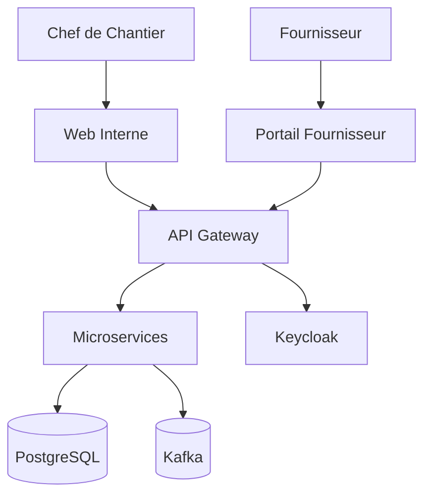

# Architecture CSE Platform

## Vue d'ensemble
Architecture microservices en Clean/Hexagonale. Communication REST synchrone + Kafka asynchrone. Keycloak pour l'identité.

## Diagramme C4 (niveau contexte)

