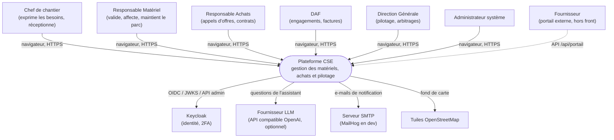
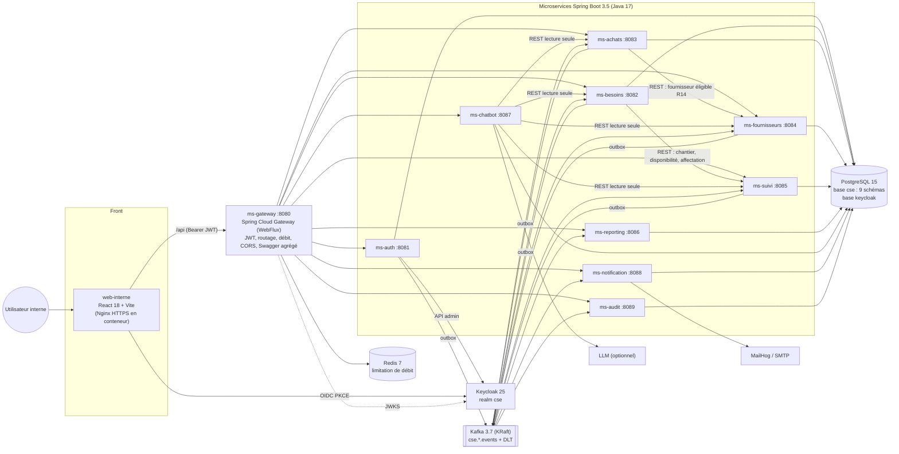
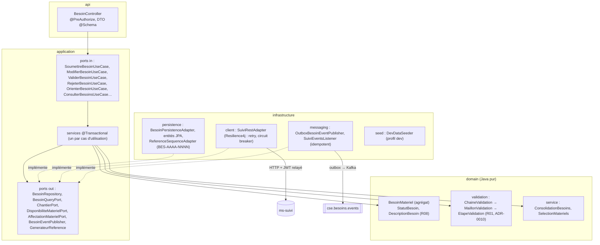
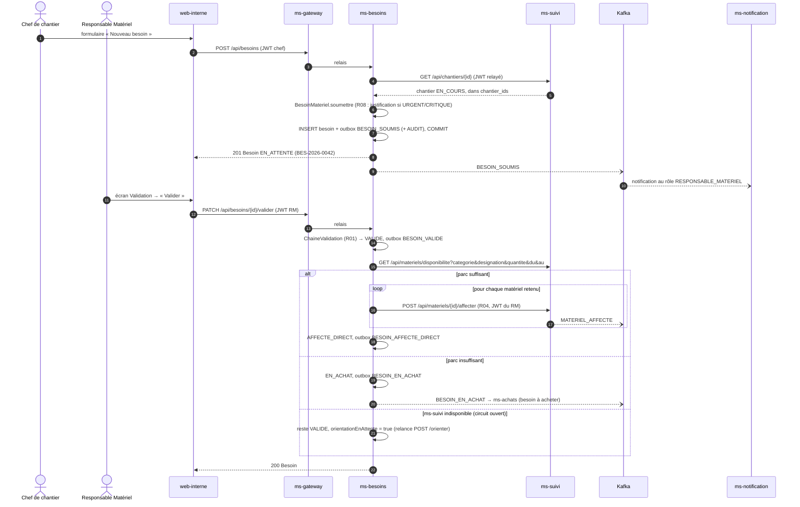
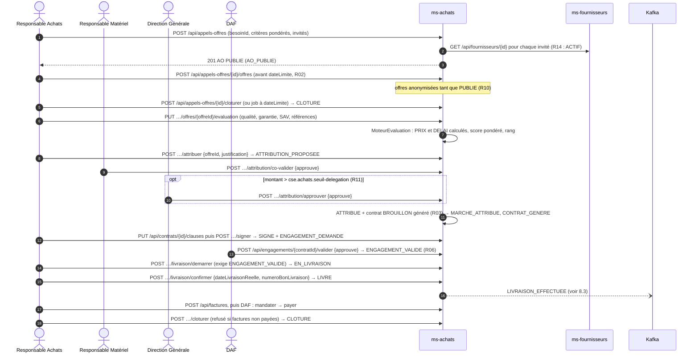
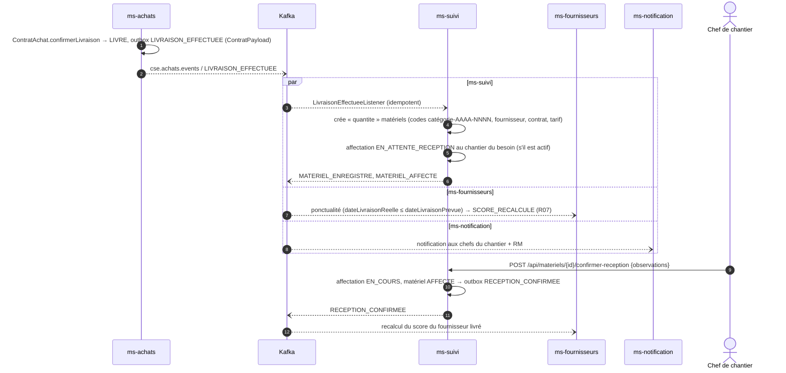
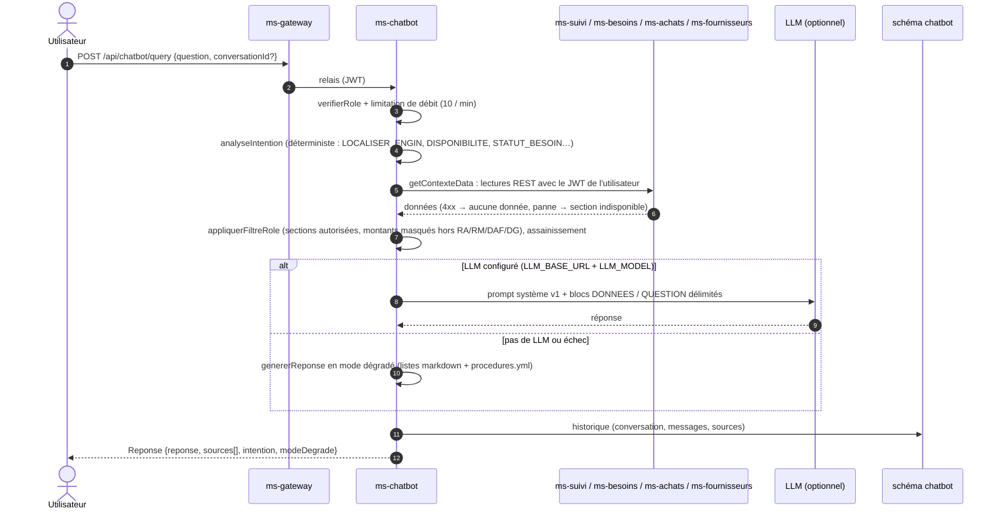

# Architecture : plateforme CSE

> Public : équipe projet, encadrant, développeurs. Les choix structurants sont justifiés dans les
> [ADR](../DECISIONS.md) ; le contrat d'API et d'événements fait foi : [API_CONTRACT.md](API_CONTRACT.md).
> Sources de la conception : `docs/inputs/` (cahier des charges, cahier de spécifications techniques,
> annexe UML : classes, composants, déploiement, séquence).

## 1. Principes

- **Microservices** découpés par contexte métier (D1, [ADR-0001](adr/0001-architecture-microservices.md)) :
  six services métier (besoins, achats, fournisseurs, suivi, reporting, chatbot) et quatre services
  techniques (passerelle, auth, notification, audit).
- **Architecture hexagonale** dans chaque service : `domain` (Java pur) ← `application` (ports, cas
  d'utilisation) ← `infrastructure` / `api` (adaptateurs). Vérifiée par ArchUnit (`HexagonalArchitectureRules`).
- **Database per Service** : une base PostgreSQL 15, un schéma et un utilisateur par service, aucun accès
  croisé ([ADR-0004](adr/0004-database-per-service.md)).
- **REST synchrone** pour les lectures et commandes qui exigent une réponse immédiate ; **Kafka asynchrone**
  pour propager les faits métier (outbox transactionnelle, consommateurs idempotents,
  [ADR-0007](adr/0007-outbox-et-audit.md), [events.md](events.md)). Pas d'annuaire de services : URL par
  configuration / DNS Docker (D4).
- **Keycloak** comme unique fournisseur d'identité ; JWT vérifié à la passerelle **et** dans chaque service
  ([SECURITY.md](SECURITY.md)).
- **CQRS** pour le pilotage : ms-reporting ne lit que ses vues alimentées par les événements (D3).

## 2. C4, niveau 1 : contexte

## 3. C4, niveau 2 : conteneurs

## 4. Microservices

| Service | Port | Schéma / utilisateur | Responsabilités | Produit (topic) | Consomme |
|---|---|---|---|---|---|
| ms-gateway | 8080 | - | point d'entrée unique, validation JWT, RBAC portail/plateforme, limitation de débit Redis, CORS, corrélation, coupe-circuits, Swagger agrégé, `GET /api/plateforme/etat` | - | - |
| ms-auth | 8081 | `auth` / `ms_auth` | profils métier (hiérarchie `Utilisateur` SINGLE_TABLE), administration des comptes via l'API Keycloak, synchronisation Keycloak → profils, `/api/me` | `UTILISATEUR_*` (`cse.auth.events`) | - |
| ms-besoins | 8082 | `besoins` / `ms_besoins` | expression des besoins, chaîne de validation (R01), orientation parc/achat, historique, consolidation | `BESOIN_*` (`cse.besoins.events`) | `MATERIEL_AFFECTE` |
| ms-achats | 8083 | `achats` / `ms_achats` | besoins à acheter, appels d'offres, offres anonymisées, évaluation multicritère, attribution co-validée, contrats, engagements DAF, livraisons, factures, synthèse financière, PV PDF, portail (offres, factures) | `AO_*`, `OFFRE_DEPOSEE`, `ATTRIBUTION_*`, `MARCHE_ATTRIBUE`, `CONTRAT_*`, `ENGAGEMENT_*`, `LIVRAISON_*`, `ALERTE_RETARD_LIVRAISON`, `FACTURE_*` (`cse.achats.events`) | `BESOIN_EN_ACHAT`, `FOURNISSEUR_*`, `SCORE_RECALCULE`, `DOCUMENT_EXPIRE` |
| ms-fournisseurs | 8084 | `fournisseurs` / `ms_fournisseurs` | référentiel, cycle de vie et blacklistage (R09), documents, évaluations et score (R07), catalogue et historique des prix, comparaison, litiges, portail (profil, catalogue) | `FOURNISSEUR_*`, `SCORE_RECALCULE`, `DOCUMENT_EXPIRE`, `LITIGE_*` (`cse.fournisseurs.events`) | `LIVRAISON_EFFECTUEE`, `RECEPTION_CONFIRMEE` |
| ms-suivi | 8085 | `suivi` / `ms_suivi` | chantiers, parc et états, affectations anti-conflit (R04), réceptions, compteurs, maintenance, pannes, réforme (R13), carte GeoJSON, planning, types d'engins, alertes planifiées | `CHANTIER_*`, `MATERIEL_*`, `RECEPTION_CONFIRMEE`, `AFFECTATION_TERMINEE`, `FIN_AFFECTATION_PROCHAINE`, `MAINTENANCE_*`, `PANNE_SIGNALEE`, `ALERTE_MAINTENANCE` (`cse.suivi.events`) | `LIVRAISON_EFFECTUEE` |
| ms-reporting | 8086 | `reporting` / `ms_reporting` | vues CQRS, KPI par profil, séries temporelles, exports PDF/Excel | - | tous les types de `besoins`, `suivi`, `fournisseurs`, `achats` |
| ms-chatbot | 8087 | `chatbot` / `ms_chatbot` | assistant : intentions, lecture des services avec le JWT de l'utilisateur, filtre par rôle, LLM optionnel ou mode dégradé, historique | - | - |
| ms-notification | 8088 | `notification` / `ms_notification` | notifications in-app (liste, compteur, SSE) et e-mails selon des règles YAML, annuaire local | - | `besoins`, `suivi`, `fournisseurs`, `achats`, `auth` |
| ms-audit | 8089 | `audit` / `ms_audit` | journal d'audit immuable, recherche, statistiques | - | `AUDIT` (`cse.audit.events`) |

Chaque service a son README : `backend/ms-*/README.md` (règles, configuration, tests).

### Modules partagés

- `backend/cse-common` : sécurité JWT Keycloak (`KeycloakJwtConverter`, `CurrentUser`, `Roles`), erreurs RFC 7807,
  pagination bornée, outbox et relais, idempotence + DLT, client REST inter-services (relais JWT et corrélation),
  chiffrement AES-GCM, OpenAPI, règles ArchUnit, migration commune `db/common`, test-jar (`CseJwt`,
  `PostgresTestConfiguration`). Détails : [BACKEND_CONVENTIONS.md](BACKEND_CONVENTIONS.md) §1.
- `backend/cse-events` : contrats d'événements (enveloppe, topics, types, payloads), voir [events.md](events.md).

## 5. C4, niveau 3 : composants de ms-besoins

Tous les services suivent ce découpage ; ms-besoins est représentatif (règles, appel synchrone, événements).

Règles ArchUnit (5 par service, `HexagonalArchitectureRules.toutes()`, exécutées comme `DynamicTest`) :
`DOMAINE_PUR` (ni Spring, ni JPA/Hibernate, ni Jackson, ni Kafka, ni Lombok, ni autre couche),
`APPLICATION_SANS_ADAPTATEURS` (ni `infrastructure`, ni `api`, ni JPA/Spring Web/Kafka/Data),
`API_SANS_INFRASTRUCTURE`, `CONTROLEURS_DANS_API`, `ENTITES_JPA_DANS_INFRASTRUCTURE`. ms-gateway (sans
domaine) a ses 2 règles propres, dont l'interdiction de Spring MVC.

## 6. Propriété des données

| Donnée | Propriétaire (écriture) | Copies locales (lecture, alimentées par événements) |
|---|---|---|
| Utilisateurs, rôles, attributs | Keycloak (fait foi) → profil ms-auth | annuaire ms-notification (`annuaire_utilisateurs`) |
| Chantiers, matériels, affectations, maintenances, pannes | ms-suivi | vues ms-reporting |
| Besoins et historique | ms-besoins | `besoin_a_acheter` (ms-achats), vues ms-reporting |
| Fournisseurs, scores, catalogue, litiges | ms-fournisseurs | `fournisseur_projection` (ms-achats, statut R14), vues ms-reporting |
| AO, offres, contrats, engagements, factures | ms-achats | vues ms-reporting ; matériels créés par ms-suivi à la livraison |
| Notifications | ms-notification | - |
| Conversations de l'assistant | ms-chatbot | - |
| Journal d'audit | ms-audit | - |

Aucun service ne lit le schéma d'un autre (permissions PostgreSQL). Les identifiants sont des UUID
générés par l'application ; les références lisibles (`BES-2026-0001`, `AO-2026-001`, `CTR-2026-001`,
`OT-2026-0001`, `LIT-2026-001`) viennent de séquences PostgreSQL annuelles.

## 7. Flux synchrones et asynchrones

| Interaction | Mode | Pourquoi | Résilience |
|---|---|---|---|
| Front → services | REST via passerelle | réponse immédiate | coupe-circuit par route, 503 `SERVICE_INDISPONIBLE` |
| ms-besoins → ms-suivi (chantier actif, disponibilité, affectation) | REST, JWT de l'utilisateur relayé | l'orientation doit être décidée dans la requête du RM | retry ×3 (réseau/5xx), circuit breaker ; panne → besoin `VALIDE` + `orientationEnAttente` ([ADR-0009](adr/0009-orientation-des-besoins.md)) |
| ms-achats → ms-fournisseurs (fournisseur `ACTIF`, R14) | REST | contrôle à la publication de l'AO / saisie d'offre | repli sur la projection locale, sinon 503 `FOURNISSEURS_INDISPONIBLE` |
| ms-chatbot → suivi, besoins, achats, fournisseurs | REST lecture seule | contexte de la question | panne d'une source → section « indisponible », réponse dégradée |
| ms-auth → Keycloak | REST (client_credentials) | gestion des comptes | 503 `IDENTITE_INDISPONIBLE` ; synchronisation avec relance |
| Besoin en achat → ms-achats | Kafka `BESOIN_EN_ACHAT` | découplage, l'achat n'est pas bloquant | outbox + idempotence + DLT |
| Livraison → création des matériels | Kafka `LIVRAISON_EFFECTUEE` | ms-suivi propriétaire du parc | idem |
| Réception, livraison → score fournisseur | Kafka `RECEPTION_CONFIRMEE`, `LIVRAISON_EFFECTUEE` | R07 recalculé de façon asynchrone | idem |
| Tous les faits → reporting, notifications, audit | Kafka | lecture analytique, effets de bord | idem |

## 8. Diagrammes de séquence

### 8.1 Soumission, validation et orientation d'un besoin

### 8.2 Cycle d'achat

### 8.3 Livraison → création des matériels → réception

### 8.4 Requête à l'assistant (chatbot)

Pipeline repris de la figure 5 de l'annexe UML.

## 9. Correspondance UML (annexe) ↔ code

### 9.1 Classes

| Classe UML | Implémentation | Service |
|---|---|---|
| `Utilisateur` (abstraite) | `sn.cse.auth.domain.model.Utilisateur` (scellée) + fabrique `Utilisateurs` ; entité JPA SINGLE_TABLE | ms-auth |
| `ChefDeChantier.soumettreBesoin()` | `SoumettreBesoinUseCase` → `BesoinMateriel` | ms-besoins |
| `ChefDeChantier.confirmerReception()` | `POST /api/materiels/{id}/confirmer-reception` → `Affectation` / `Materiel` | ms-suivi |
| `ChefDeChantier.signalerPanne()` | `Panne` (`POST /api/pannes`) | ms-suivi |
| `ResponsableMateriel.validerBesoin()` | `BesoinMateriel.valider` + `ChaineValidation` | ms-besoins |
| `ResponsableMateriel.affecterMateriel()` | `Materiel.affecter` + `PolitiqueAffectation` (R04) | ms-suivi |
| `ResponsableMateriel.planifierMaintenance()` | `Maintenance` (ordre de travail `OT-AAAA-NNNN`) | ms-suivi |
| `ResponsableAchats.publierAppelOffre()` / `attribuerMarche()` | `PublicationAppelOffreService`, `AttributionMarcheService` → `AppelOffre` | ms-achats |
| `DAF.validerEngagement()` / `mandaterPaiement()` | `EngagementService` (`ContratAchat` + `Engagement`), `FactureService` → `Facture` | ms-achats |
| `DirectionGenerale.consulterTableauBord()` | `GET /api/reporting/kpis` (profil `DG`) | ms-reporting |
| `Fournisseur.deposerOffre()` / `livrerMateriel()` | portail `/api/portail/appels-offres/{id}/offres` ; livraison confirmée par le RA (`ContratAchat`) | ms-achats |
| `Fournisseur` (ninea, scorePerformance) | agrégat `sn.cse.fournisseurs.domain.model.Fournisseur` + `ScorePolicy` ; compte utilisateur `auth…Fournisseur(fournisseurId)` | ms-fournisseurs, ms-auth |
| `BesoinMateriel` (`valider()`, `rejeter(motif)`) | agrégat `BesoinMateriel` + `HistoriqueBesoin` | ms-besoins |
| `AppelOffre` (`publier()`, `cloturer()`) | agrégat `AppelOffre` (offres, critères, attribution) | ms-achats |
| `Offre.evaluer()` | `Offre` + `MoteurEvaluation` / `StrategieNotation` (`NotationPrix`, `NotationDelai`, `NotationSaisie`) | ms-achats |
| `ContratAchat.signer()` | agrégat `ContratAchat` (clauses, jalons, engagement, pénalités) | ms-achats |
| `Materiel.changerEtat()` | `Materiel` + machine à états `EtatMateriel` | ms-suivi |
| `Chantier` | agrégat `Chantier` (code, région, coordonnées, budget, marché) | ms-suivi |
| Énumérations `StatutBesoin`, `Priorite`, `StatutAO`, `CategorieMateriel`, `EtatMateriel`, `StatutChantier` | enums Java + types `ENUM` PostgreSQL natifs, valeurs identiques | services propriétaires |

### 9.2 Écarts assumés

| Écart | Raison | Référence |
|---|---|---|
| `Utilisateur.motDePasseHash` et `authentifier()` absents | l'authentification est entièrement déléguée à Keycloak | [ADR-0012](adr/0012-pas-de-mot-de-passe-local.md) |
| `ResponsableAchats.seuilDelegation` non lu depuis le profil | seuil global configurable `cse.achats.seuil-delegation` (150 M FCFA) | [ADR-0011](adr/0011-seuil-delegation.md) |
| Validation des besoins par chaîne de responsabilité configurable (au lieu d'un `valider()` direct du RM) | R01 aujourd'hui, extension « Directeur de projet » sans code | [ADR-0010](adr/0010-chaine-validation-besoins.md) |
| Orientation automatique après validation, relance manuelle si ms-suivi est indisponible | jamais d'achat dû à une panne technique, aucun compte de service privilégié | [ADR-0009](adr/0009-orientation-des-besoins.md) |
| `ChefDeChantier.chantierAttribue` (un chantier) → `chantierIds` (plusieurs) | les comptes de démonstration couvrent deux chantiers ; claim `chantier_ids` | [API_CONTRACT.md](API_CONTRACT.md) §0 |
| `Fournisseur` à la fois compte utilisateur (ms-auth) et agrégat métier (ms-fournisseurs) | l'identité et le référentiel ont des cycles de vie distincts ; lien par `fournisseur_id` | D2, D7 |
| Classes ajoutées : `Affectation`, `Maintenance`, `Panne`, `TypeEngin`, `Mouvement`, `Facture`, `Engagement`, `Litige`, `Evaluation`, `LigneCatalogue`, `DocumentAdministratif` | exigées par le cahier de spécifications (B.4-B.10), absentes du diagramme de classes | cahier de spécifications techniques |
| Rôle du discriminateur `role` en `VARCHAR` + `CHECK` (pas `ENUM`) | contrainte Hibernate sur les discriminateurs | [ADR-0013](adr/0013-ms-auth-synchronisation-keycloak.md) |
| Diagramme de composants : bases « Besoins & Achats » et « Fournisseurs & Suivi » partagées | un schéma + un utilisateur par service, aucun accès croisé | [ADR-0004](adr/0004-database-per-service.md) |
| Diagramme de composants : liaisons directes achats → suivi (« contrat signé ») et suivi → fournisseurs (« évalue ») | réalisées par événements (`LIVRAISON_EFFECTUEE`, `RECEPTION_CONFIRMEE`) : pas de couplage temporel | [ADR-0007](adr/0007-outbox-et-audit.md) |
| Services ms-auth, ms-notification, ms-audit absents des diagrammes | exigés par la spécification technique | [DECISIONS.md](../DECISIONS.md) D1 |
| Diagramme de déploiement : « API Gateway + Keycloak » sur un même nœud | conteneurs séparés (Keycloak a sa base `keycloak`) ; même nœud possible en production | `infra/docker-compose.yml` |
| Pas d'Eureka | URL par configuration / DNS Docker | [DECISIONS.md](../DECISIONS.md) D4 |
| Spring Boot 3.5 / Spring Cloud 2025.0 / Spring AI 1.0 | compatibilité Spring AI GA et Docker 29 | [ADR-0005](adr/0005-versions-socle.md) |

## 10. Déploiement

| Environnement | Composition | Commande |
|---|---|---|
| Développement | infrastructure en Docker (PostgreSQL :5433, Kafka :9092, Keycloak :8180, Redis :6379, MailHog :1025/:8025), 10 services sur l'hôte (JVM 256 Mo, profil `dev`), front Vite :5173 | `make infra build start front` |
| Recette / démonstration | tout en conteneurs (profil Compose `apps`) : 10 services, frontal Nginx HTTPS :8443, service `backup` | `make up` |

Détails, variables, sauvegardes et supervision : [OPERATIONS.md](OPERATIONS.md).
