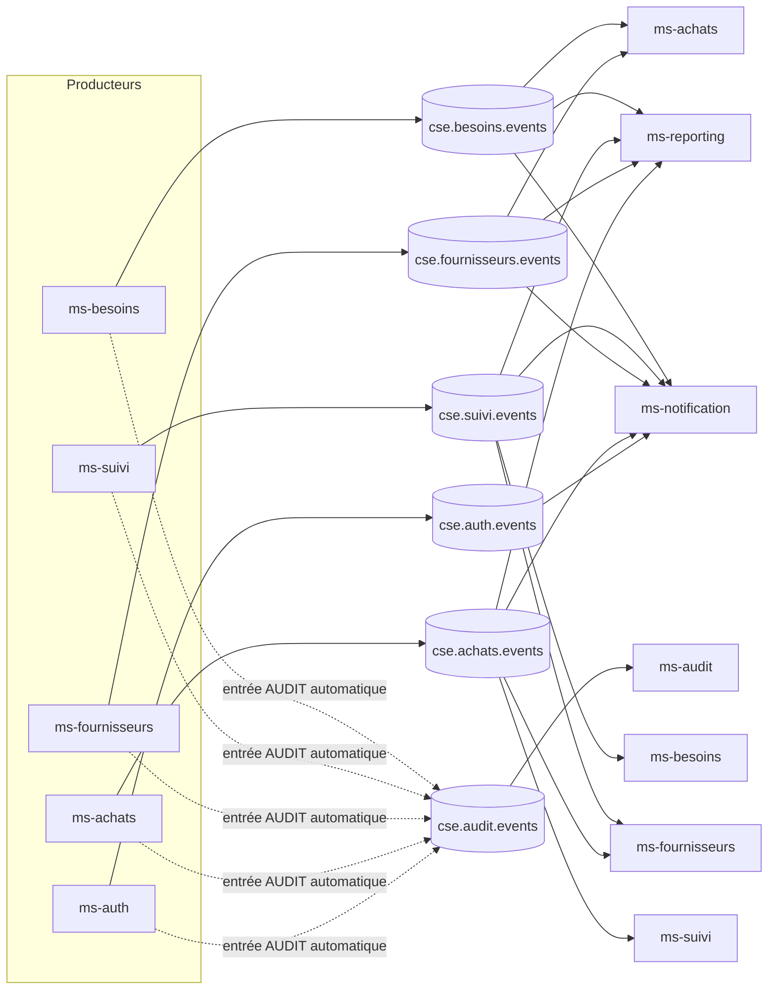
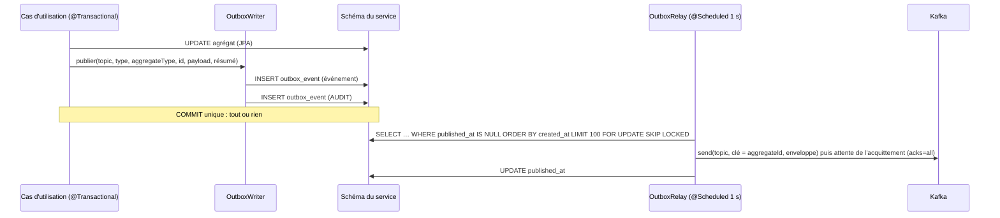

# Catalogue des événements Kafka

> Source de vérité du code : module `backend/cse-events` (`Topics`, `EventTypes`, `EventEnvelope`, `Actor`,
> `sn.cse.events.payload.*`). Contrat fonctionnel : [`API_CONTRACT.md`](API_CONTRACT.md) §11.
> Mécanique de publication et de consommation : `backend/cse-common` (`outbox`, `messaging`). Décision : [ADR-0007](adr/0007-outbox-et-audit.md).

## 1. Vue d'ensemble



| Topic (`Topics.*`) | Producteur | Groupes consommateurs (`groupId` = `spring.application.name`) |
|---|---|---|
| `cse.besoins.events` (`BESOINS`) | ms-besoins | ms-achats, ms-reporting, ms-notification |
| `cse.suivi.events` (`SUIVI`) | ms-suivi | ms-besoins, ms-fournisseurs, ms-reporting, ms-notification |
| `cse.fournisseurs.events` (`FOURNISSEURS`) | ms-fournisseurs | ms-achats, ms-reporting, ms-notification |
| `cse.achats.events` (`ACHATS`) | ms-achats | ms-suivi, ms-fournisseurs, ms-reporting, ms-notification |
| `cse.auth.events` (`AUTH`) | ms-auth | ms-notification (annuaire) |
| `cse.audit.events` (`AUDIT`) | tous les producteurs (outbox) | ms-audit |
| `<topic>.DLT` (`DLT_SUFFIX`) | gestionnaire d'erreurs commun | exploitation (lecture manuelle) |

Les topics et leurs DLT sont créés au démarrage par `MessagingAutoConfiguration` (`KafkaAdmin.NewTopics`,
`cse.kafka.partitions` = 3 et `cse.kafka.replicas` = 1 par défaut). La création automatique de topics est
désactivée côté broker (`KAFKA_CFG_AUTO_CREATE_TOPICS_ENABLE=false`).

ms-reporting, ms-notification, ms-audit et ms-chatbot ne publient rien (relais d'outbox désactivé,
`cse.outbox.relay-enabled=false`, sauf ms-chatbot qui n'a pas d'outbox utile).

## 2. Enveloppe

Tout message Kafka est une `EventEnvelope` sérialisée en JSON ; la **clé Kafka est `aggregateId`**, ce qui
garantit l'ordre des événements d'un même agrégat (une partition par clé).

| Champ | Type | Description |
|---|---|---|
| `eventId` | UUID | identifiant unique, clé d'idempotence des consommateurs |
| `type` | string | valeur de `EventTypes` (ex. `BESOIN_VALIDE`) |
| `version` | int | version du schéma de payload (`EventEnvelope.CURRENT_VERSION = 1`) |
| `occurredAt` | instant ISO-8601 UTC | instant de survenue (horloge `Clock` du service) |
| `source` | string | microservice émetteur (`ms-besoins`…) |
| `aggregateType` | string | type d'agrégat (`BesoinMateriel`, `ContratAchat`…) |
| `aggregateId` | string | identifiant de l'agrégat (clé Kafka) |
| `correlationId` | string? | `X-Correlation-Id` de la requête HTTP d'origine (MDC), `null` pour un job |
| `actor` | `{id, nom, roles[]}` | auteur ; `Actor.SYSTEME` (`id=null`, `nom="Système"`) pour les traitements planifiés |
| `payload` | objet JSON | instantané métier (voir §4) |

Exemple réel (abrégé) :

```json
{
  "eventId": "6f1c2a8e-3b9d-4f57-9a43-1e0c7d2b9f10",
  "type": "BESOIN_VALIDE",
  "version": 1,
  "occurredAt": "2026-10-30T09:15:00Z",
  "source": "ms-besoins",
  "aggregateType": "BesoinMateriel",
  "aggregateId": "b0000000-0000-0000-0000-000000000037",
  "correlationId": "a1b2c3d4e5",
  "actor": { "id": "00000000-0000-0000-0000-000000000201", "nom": "Ibrahima Fall", "roles": ["RESPONSABLE_MATERIEL"] },
  "payload": { "besoinId": "b0000000-0000-0000-0000-000000000037", "reference": "BES-2026-0037", "statut": "VALIDE", "...": "..." }
}
```

**Compatibilité des schémas** : les payloads sont des records Java ; on n'ajoute que des champs optionnels
(les consommateurs utilisent un `ObjectMapper` tolérant aux champs inconnus et les nouveaux champs sont
`null` dans les anciens messages — exemple : `dateMandatement`/`datePaiement` ajoutés à `FacturePayload`,
ms-reporting retombe sur la date de l'événement quand ils sont absents). Une rupture (renommage,
suppression, changement de type) impose d'incrémenter `version` et de faire cohabiter les deux lectures.

## 3. Catalogue complet

Colonne « Consommateurs » : consommateurs **effectifs** dans le code (listeners + règles de routage de
ms-notification déclarées dans `ms-notification/src/main/resources/application.yml`, `cse.notification.regles` ;
entre parenthèses : destinataires et envoi d'e-mail). Les types sans règle ne produisent pas de notification. ms-reporting
consomme tous les types de ses quatre topics (§ vues dans `backend/ms-reporting/README.md`). Chaque
événement de domaine produit en plus une entrée `AUDIT` (§6).

### 3.1 ms-besoins — `cse.besoins.events`, payload `BesoinPayload`, agrégat `BesoinMateriel`

| Type | Déclencheur | Consommateurs |
|---|---|---|
| `BESOIN_SOUMIS` | `POST /api/besoins` | reporting, notification (RM) |
| `BESOIN_MODIFIE` | `PUT /api/besoins/{id}` (statut `EN_ATTENTE`) | reporting |
| `BESOIN_VALIDE` | dernière étape de la chaîne de validation (R01) | reporting, notification (demandeur) |
| `BESOIN_REJETE` | `PATCH …/rejeter` (motif R08) | reporting, notification (demandeur, e-mail) |
| `BESOIN_AFFECTE_DIRECT` | orientation : parc suffisant | reporting, notification (demandeur, e-mail) |
| `BESOIN_EN_ACHAT` | orientation : parc insuffisant | **ms-achats** (projection `besoin_a_acheter`), reporting, notification (demandeur) |

`BesoinPayload {besoinId, reference, chantierId, chantierNom, demandeurId, demandeurNom, designation,
categorie, quantite, specifications?, priorite, statut, dateBesoin, dureeUtilisationJours, motif?, materielIds[]}`

### 3.2 ms-suivi — `cse.suivi.events`

| Type | Payload | Déclencheur | Consommateurs |
|---|---|---|---|
| `CHANTIER_CREE`, `CHANTIER_MODIFIE` | `ChantierPayload` | création, modification, clôture d'un chantier | reporting |
| `MATERIEL_ENREGISTRE` | `MaterielPayload` | création manuelle ou à la livraison | reporting |
| `MATERIEL_ETAT_CHANGE` | `MaterielPayload` | `PATCH /api/materiels/{id}/etat` | reporting |
| `MATERIEL_REFORME_DEMANDEE` | `MaterielPayload` | demande de réforme RM (R13 étape 1) | reporting, notification (DG, e-mail) |
| `MATERIEL_REFORME` | `MaterielPayload` | validation DG (R13 étape 2) | reporting, notification (RM) |
| `ALERTE_MAINTENANCE` | `MaterielPayload` | job quotidien (seuil heures/jours) | reporting, notification (RM, e-mail) |
| `MATERIEL_AFFECTE` | `AffectationPayload` | `POST …/affecter` | **ms-besoins** (historique si `besoinId`), reporting, notification (chefs du chantier, e-mail) |
| `RECEPTION_CONFIRMEE` | `AffectationPayload` | `POST …/confirmer-reception` | **ms-fournisseurs** (recalcul du score si `fournisseurId`), reporting |
| `AFFECTATION_TERMINEE` | `AffectationPayload` | `POST …/liberer` | reporting |
| `FIN_AFFECTATION_PROCHAINE` | `AffectationPayload` | job quotidien (J-3) | reporting, notification (RM + chefs) |
| `MAINTENANCE_PLANIFIEE`, `MAINTENANCE_DEMARREE`, `MAINTENANCE_CLOTUREE` | `MaintenancePayload` | ordres de travail | reporting |
| `PANNE_SIGNALEE` | `PannePayload` | `POST /api/pannes` | reporting, notification (RM ; niveau `CRITIQUE` + e-mail si gravité `BLOQUANTE`) |

- `ChantierPayload {chantierId, code, nom, region, statut, budget, montantMarche, chefChantierId?, dateDebut, dateFinPrevue?}`
- `MaterielPayload {materielId, code, designation, categorie, etat, chantierId?, chantierNom?, tarifJournalier, valeurAcquisition?, heuresFonctionnement, fournisseurId?, contratId?, motif?}`
- `AffectationPayload {affectationId, materielId, materielCode, materielDesignation, categorie, tarifJournalier, chantierId, chantierNom, chefChantierId?, besoinId?, dateDebut, dateFinPrevue, dateFinReelle?, statut, fournisseurId?, contratId?}`
- `MaintenancePayload {maintenanceId, numeroOt, materielId, materielDesignation, chantierId?, type, statut, cout?, datePlanifiee, dateDebut?, dateFin?}`
- `PannePayload {panneId, materielId, materielDesignation, chantierId?, chantierNom?, gravite, description, signaleParId, signaleParNom}`

### 3.3 ms-fournisseurs — `cse.fournisseurs.events`

| Type | Payload | Déclencheur | Consommateurs |
|---|---|---|---|
| `FOURNISSEUR_INSCRIT` | `FournisseurPayload` | création (RA) ou inscription | ms-achats (projection), reporting, notification (RA) |
| `FOURNISSEUR_VALIDE` | `FournisseurPayload` | `valider-inscription` | ms-achats, reporting |
| `FOURNISSEUR_MODIFIE` | `FournisseurPayload` | `PUT /api/fournisseurs/{id}`, profil portail | ms-achats, reporting |
| `FOURNISSEUR_SUSPENDU`, `FOURNISSEUR_REACTIVE` | `FournisseurPayload` | suspension / réactivation | ms-achats (R14), reporting |
| `FOURNISSEUR_BLACKLISTAGE_DEMANDE` | `FournisseurPayload` | R09 étape 1 (RA) | ms-achats, reporting, notification (DG, e-mail) |
| `FOURNISSEUR_BLACKLISTE` | `FournisseurPayload` | R09 étape 2 approuvée (DG) | ms-achats, reporting |
| `FOURNISSEUR_BLACKLISTAGE_REFUSE` | `FournisseurPayload` | R09 étape 2 refusée | ms-achats, reporting, notification (RA) |
| `SCORE_RECALCULE` | `FournisseurPayload` | évaluation, livraison, réception, litige ; job (motif `ALERTE : …` si score < seuil) | ms-achats, reporting, notification (RA, si alerte) |
| `DOCUMENT_EXPIRE` | `FournisseurPayload` | job quotidien | ms-achats, reporting, notification (RA) |
| `LITIGE_OUVERT` | `LitigePayload` | `POST …/litiges` | reporting, notification (RA) |
| `LITIGE_RESOLU` | `LitigePayload` | action `RESOLUTION` ou `CLASSEMENT` (`statut=CLASSE`) | reporting |

- `FournisseurPayload {fournisseurId, raisonSociale, email, specialites[], statut, scorePerformance, motif?}`
- `LitigePayload {litigeId, reference, fournisseurId, raisonSociale, contratId?, objet, gravite, statut}`

### 3.4 ms-achats — `cse.achats.events`

| Type | Payload | Déclencheur | Consommateurs |
|---|---|---|---|
| `AO_PUBLIE` | `AppelOffrePayload` | `POST /api/appels-offres` | reporting, notification (RM) |
| `OFFRE_DEPOSEE` | `AppelOffrePayload` | saisie interne ou portail | reporting |
| `AO_CLOTURE` | `AppelOffrePayload` | clôture manuelle ou job à `dateLimite` | reporting |
| `ATTRIBUTION_PROPOSEE` | `AppelOffrePayload` | `POST …/attribuer` (RA) | reporting, notification (RM ; DG si `approbationDgRequise`), e-mail |
| `ATTRIBUTION_REFUSEE` | `AppelOffrePayload` | refus RM ou DG (R11) | reporting, notification (RA) |
| `MARCHE_ATTRIBUE` | `AppelOffrePayload` | toutes approbations obtenues | reporting, notification (RA, e-mail) |
| `CONTRAT_GENERE` | `ContratPayload` | génération du contrat `BROUILLON` (R03) | reporting |
| `CONTRAT_SIGNE` | `ContratPayload` | `POST …/signer` | reporting |
| `ENGAGEMENT_DEMANDE` | `ContratPayload` | à la signature | reporting, notification (DAF, e-mail) |
| `ENGAGEMENT_VALIDE`, `ENGAGEMENT_REJETE` | `ContratPayload` | décision DAF (R06) | reporting, notification (RA ; e-mail si rejet) |
| `LIVRAISON_DEMARREE` | `ContratPayload` | `POST …/livraison/demarrer` | reporting |
| `LIVRAISON_EFFECTUEE` | `ContratPayload` | `POST …/livraison/confirmer` | **ms-suivi** (création des matériels), **ms-fournisseurs** (ponctualité), reporting, notification (chefs du chantier + e-mail ; RM) |
| `ALERTE_RETARD_LIVRAISON` | `ContratPayload` | job quotidien | reporting, notification (RA, e-mail) |
| `CONTRAT_CLOTURE` | `ContratPayload` | `POST …/cloturer` | reporting |
| `FACTURE_RECUE` | `FacturePayload` | `POST /api/factures` (ou portail) | reporting, notification (DAF) |
| `FACTURE_MANDATEE`, `FACTURE_PAYEE`, `FACTURE_REJETEE` | `FacturePayload` | actions DAF | reporting |

- `AppelOffrePayload {appelOffreId, reference, objet, type, besoinId?, chantierId?, categorie, quantite, dateLimite, statut, nombreOffres, fournisseurIdsInvites[], offreRetenueId?, fournisseurRetenuId?, montantAttribue?, approbationDgRequise}`
- `ContratPayload {contratId, numero, appelOffreId, besoinId?, chantierId?, chantierNom?, fournisseurId, fournisseurNom, designation, categorie, quantite, montant, statut, dateSignature?, dateLivraisonPrevue?, dateLivraisonReelle?, tarifJournalierEstime?}`
- `FacturePayload {factureId, numero, contratId, fournisseurId, montantTtc, statut, dateEmission, dateEcheance, dateMandatement?, datePaiement?}`

> Les montants voyagent en clair dans Kafka (réseau interne) alors qu'ils sont chiffrés au repos dans
> ms-achats : voir [SECURITY.md](SECURITY.md) §6 (limite connue).

### 3.5 ms-auth — `cse.auth.events`, payload `UtilisateurPayload`

| Type | Déclencheur | Consommateurs |
|---|---|---|
| `UTILISATEUR_CREE` | `POST /api/admin/utilisateurs` | ms-notification (annuaire e-mails / chefs de chantier) |
| `UTILISATEUR_MODIFIE` | modification, changement de statut | ms-notification |
| `UTILISATEUR_SYNCHRONISE` | synchronisation Keycloak → profils, provisionnement par `/api/me` | ms-notification |

`UtilisateurPayload {utilisateurId, email, prenom, nom, role, actif, chantierIds[]}`

### 3.6 Transverse — `cse.audit.events`

| Type | Payload | Producteur | Consommateur |
|---|---|---|---|
| `AUDIT` | `AuditPayload {service, action, entite, entiteId, resume?}` | `OutboxWriter` de chaque producteur | ms-audit (table `audit_log`, ajout seul) |

## 4. Publication : Transactional Outbox



- `OutboxWriter.publier` est en `Propagation.MANDATORY` : appelée hors transaction, elle lève une exception.
  Il n'y a donc ni événement sans écriture, ni écriture sans événement.
- `OutboxRelay` publie dans l'ordre de création ; au premier échec, le lot s'interrompt (ordre préservé),
  `attempts` et `last_error` sont mis à jour, le passage suivant réessaie. `SKIP LOCKED` autorise plusieurs
  instances sans double publication.
- Purge quotidienne (`cse.outbox.purge-cron`, défaut 02:30) des événements publiés depuis plus de
  `cse.outbox.retention` (7 jours).
- Paramètres `cse.outbox.*` : `relay-enabled` (true), `batch-size` (100), `send-timeout` (5 s), `retention`
  (P7D), `interval` (PT1S).

Supervision : `SELECT count(*), max(attempts) FROM <schema>.outbox_event WHERE published_at IS NULL;`
doit rester proche de 0 ; un `last_error` persistant signale un broker injoignable.

## 5. Consommation : idempotence, rejeu, DLT

```java
@KafkaListener(topics = Topics.ACHATS, groupId = "${spring.application.name}")
void onMessage(String message) {
  EventEnvelope env = reader.lire(message);           // IllegalArgumentException si illisible
  if (!EventTypes.LIVRAISON_EFFECTUEE.equals(env.type())) return;
  idempotence.traiterUneFois(env.eventId(), "ms-suivi.livraison",
      () -> useCase.creerMateriels(reader.payload(env, ContratPayload.class)));
}
```

- **Idempotence** (`IdempotentEventHandler`) : `INSERT INTO processed_event (event_id, consumer, …) ON
  CONFLICT DO NOTHING` dans la **même transaction** que le traitement. Si le traitement échoue, la marque
  est annulée et l'événement sera rejoué ; s'il a déjà été traité, il est ignoré. Livraison « au moins une
  fois » + idempotence = effet « exactement une fois ».
- **Rejeu puis DLT** (`cseKafkaErrorHandler`) : `DefaultErrorHandler` avec `FixedBackOff`
  (`cse.kafka.retry-interval` = 2 s, `cse.kafka.retry-attempts` = 3), puis `DeadLetterPublishingRecoverer`
  vers `<topic>.DLT` (même partition). Les `IllegalArgumentException` (message illisible, payload
  incompatible, valeur d'énumération inconnue) partent directement en DLT, sans rejeu.
- **Ordre** : garanti par agrégat seulement. ms-reporting gère le désordre entre agrégats par horodatage
  (`maj_le`) et références provisoires ; ms-achats et ms-notification ignorent une version plus ancienne
  d'un fournisseur ou d'un utilisateur.
- **Types inconnus** : ignorés (et marqués traités chez ms-reporting) : ajouter un type n'oblige pas à
  redéployer les consommateurs.

Inspection d'une DLT (développement) :

```bash
docker exec cse-kafka-1 kafka-console-consumer.sh --bootstrap-server localhost:29092 \
  --topic cse.achats.events.DLT --from-beginning --property print.headers=true --timeout-ms 5000
```

Les en-têtes `kafka_dlt-exception-message` et `kafka_dlt-original-offset` indiquent la cause. Après
correction, republier le message sur le topic d'origine (l'idempotence protège contre les doublons).

## 6. Audit dérivé des événements

`OutboxWriter.publier` écrit, pour chaque événement de domaine, une seconde enveloppe de type `AUDIT` sur
`cse.audit.events`, avec le même `aggregateId`, le même `actor` et le même `correlationId` :
`AuditPayload {service = source, action = type de l'événement, entite = aggregateType, entiteId, resume}`.
ms-audit la stocke dans `audit_log` (table protégée par déclencheurs contre `UPDATE`/`DELETE`/`TRUNCATE`).

Conséquence (ADR-0007) : **toute modification métier doit émettre un événement**, sans quoi elle n'est pas
auditée. La revue de code le vérifie. Les lectures ne sont pas auditées.

## 7. Ajouter un événement

Voir [DEVELOPER_GUIDE.md](DEVELOPER_GUIDE.md) §4.3 : constante dans `EventTypes`, payload (nouveau record ou
champ optionnel), mise à jour de ce document et de `API_CONTRACT.md` §11, publication via un port
`application.port.out.*EventPublisher`, consommateur idempotent, règle de notification éventuelle.
